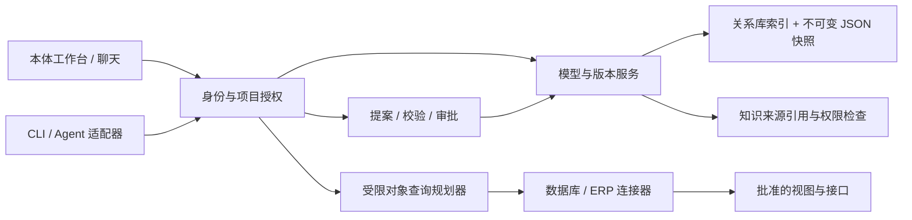

# AiAgent 客户本体工作台

日期：2026-11-13。状态：产品设计与交互原型，尚未接入平台服务。

[打开交互原型](prototype.html)。全部公司、项目、数据、证据与校验结果均为合成示例；离线运行，不连接数据库或 ERP，不调用模型。刷新重置演示状态。

## 1. 产品判断

建议在 AiAgent 新增独立的「客户本体」模块，把长期积累的客户业务认知固化成可版本管理、可查询、可修改的业务契约。知识库保存原文与解释，本体保存经过确认的对象、属性、关系、指标、规则和动作，数据库与 ERP 保持业务事实的来源。聊天、代码 Agent 和可视化读取同一版本。

例如用户问「哪些订单可能延期」，平台必须先知道：订单是什么、属于哪个客户、交付日期来自哪里、订单和工单怎么关联、延期如何计算、数据截止时间是什么。下一步才是查询数据并解释风险。

借鉴 Palantir 的对象类型、关系类型、动作与函数，以及模型权限和实例权限分开治理的思路；不复制其底层平台，也不宣称现有 AiAgent 已具备这些能力。

### Codex CLI 能力保留原则

本体模型、连接验证和预制工具链均为可选增强，现有 Codex CLI 的能力与使用体验是接入基线。普通聊天与编码无需先建模或配置连接；未选择增强时保持原有执行路径，不注入上下文或新增扩展请求。启用后仅追加用户选择的业务上下文与工具，不替换原生执行流程、不覆盖已有配置、不收窄原生工具能力，也不强制经过节点链。扩展故障只影响对应能力，支持移除或关闭后继续原有任务。

连接范围与只读策略约束本工作台管理的资源；CLI 原有操作仍按其既有权限和审批配置运行。实施与回归以 [Codex CLI 兼容边界](agent-workbench.md#codex-cli-兼容边界实施硬性要求) 为硬性要求；当前仍为设计约定，尚未实施集成。

## 2. 当前代码与接入边界

| 已核对的位置 | 已有能力 | 本方案如何使用 |
| --- | --- | --- |
| `backed/Entities/CodeRepository/AiCodeProject.cs` | 项目 ID、服务器目录、关联仓库领域 | 项目绑定本体空间，不用目录或项目显示名作为权限边界 |
| `front/lib/knowledge-types.ts` | `KnowledgeOrganization` 的 company/project 字符串分类 | 仅提供迁移候选，必须人工绑定稳定客户 ID，不按同名自动合并 |
| `backed/Services/Knowledge/KnowledgeParsedDocumentStore.cs`、`KnowledgeSemanticStore.cs` | 解析正文、语义版本的存储实现 | 引用文档版本与内容哈希，保留来源访问检查 |
| `backed/Services/Chat/ChatSkillCatalog.cs` | 显式技能入口 | 提供可选建模引导，技能不授予数据访问和发布权限 |
| `backed/Services/ChangeAtlas/` | 代码变化地图领域 | 可关联某个固定代码版本的映射实现证据，业务关系图独立建模 |
| `doc/manufacturing-ontology-prototype.html` | 已存在制造业业务认知原型 | 本次补足平台客户/项目归属、版本、聊天和 Agent 变更闭环，保留旧文件 |

以上仅为源码检查，不代表现有接口已完成集成。本次不修改应用、连接配置或数据库。

## 3. 按客户与项目组织

```text
行业模板（通用结构，无客户数据）
  └─ 客户 A 本体空间（独立成员及数据源权限）
       ├─ 公司业务定义 v12
       ├─ ERP 升级项目 → 公司 v12 + 项目覆盖 v3
       └─ 交付预警项目 → 公司 v11 + 项目覆盖 v2
  └─ 客户 B 本体空间（独立授权，不继承 A 的对象或数据）
```

客户与项目是多对多显式绑定；单项目可有多个客户绑定，但会话每次显式选择一个活动客户空间。跨客户查询后续另立授权，不自动联查。公司知识共享不表示所有项目成员可读；要求同时满足项目权限、本体空间成员权限、来源与字段权限。

行业模板采用复制和升级差异，项目采用固定基线版本加覆盖。公司模型升级不自动覆盖项目：生成影响分析、兼容检查和升级提案。对象有稳定 ID，重命名不换 ID；项目扩展须有命名空间；同一字段的覆盖冲突必须显式解决。跨客户复用结构需要去掉证据、映射、实例和客户标识。

## 4. 固化什么

| 层 | 内容 | 示例 |
| --- | --- | --- |
| 业务定义 | 对象、字段类型、业务主键、枚举、单位、币种、时区、解释 | 销售订单、订单号、承诺交期 |
| 关系 | 两端对象、方向、基数、连接键、时间有效性 | 客户 1:N 订单，订单 1:N 工单 |
| 来源映射 | 来源 ID、表/视图或 API operation、字段、转换规则、来源版本 | `SalesOrder.promisedDate ← ERP.order.delivery_date` |
| 业务口径 | 指标、过滤、空值语义、规则版本、依赖字段 | 未关闭且承诺交期早于业务日期为已逾期 |
| 证据 | 文档 ID、版本、章节、内容哈希、确认人、确认时间 | 客户交付管理规范第 4 节 |
| 业务动作 | 参数、前置条件、权限、执行器、幂等与补偿策略 | 创建催交任务，调整承诺交期 |

模型、业务实例、执行记录分别保存。页面切换「类型图」和「实例视图」，避免把模型关系误当成真实客户订单事实。模型来源标为「机器发现」「人工确认」「已发布」；没有业务确认的字段语义保留待确认状态。

## 5. 从已有资料搭建

1. 创建客户，绑定项目与授权人员。选择空白模型或行业模板。
2. 上传 DDL、数据字典、OpenAPI、脱敏 Excel、业务流程文档。初期只处理显式资料，不读取真实账号配置。
3. 后续由管理员创建只读连接。数据库发现限元数据与批准的视图，ERP 发现限批准的接口定义；默认不抽样真实行。
4. AI 输出候选对象、关系和映射，每项携带来源。主键、同义词、数量单位、订单状态、取消语义由业务人员核对，不能只凭列名确定。
5. 映射检查类型、必填、唯一性、关系基数、枚举与数据质量；记录校验样本范围。没有实例数据时明确「结构验证，数据质量未验证」。
6. 生成差异，审批发布不可变版本；项目选择引用版本，生成可导出的 JSON/Markdown/字段字典。

客户业务系统不必先搬进知识库。DDL 和接口契约描述结构，知识资料解释业务语义，查询执行器按需取事实。三者通过来源 ID、映射与版本关联。

## 6. 聊天与 Agent 如何使用

聊天输入框新增显式本体标签，例如「华辰制造 / 交付预警 / v12」。用户可直接粘贴业务描述、DDL 或接口片段，点「生成建模提案」，也可只查询已发布模型。

发送时保存客户空间、项目、模型版本和授权范围引用，重试沿用该引用；实时查询另存数据查询时间和水位。权限撤销后即使历史版本存在也不能继续读取受限数据。

上下文先给业务摘要与相关对象，再按需调用工具，不把全公司表结构和数据塞入提示词。回答区分：模型定义、带时间的查询事实、AI 推断。引用文档证据和查询执行 ID；无法查询时不能把静态示例当实时数据。

建议工具契约（新设计，未实现）：

| 工具 | 用途 | 权限 |
| --- | --- | --- |
| `ontology.describe` / `ontology.search` | 读取固定版本定义与证据 | 模型读取 + 来源权限 |
| `ontology.query` | 对象、白名单字段/过滤、有限跳数查询 | 实例/字段/行级权限 |
| `ontology.propose` | 提交基于指定版本的结构化变更 | 模型编辑，仅草稿 |
| `ontology.validate` | 检查提案与影响 | 提案访问，无外部写入 |
| `ontology.diff` | 查看版本与提案差异 | 相关版本读取 |
| `ontology.action.preview` | 生成具体对象的业务动作预览 | 独立动作权限 |

网页聊天、Codex CLI 接入适配器与 Agent 插件调用同一服务端领域 API。CLI 可采用 MCP 适配层，具体宿主配置和能力需实施时核对；不依赖宿主一定支持某插件协议。普通插件也可通过鉴权 HTTP 适配。模型侧不提供无人审批的发布工具。

外部身份采用短期且绑定客户、项目、工具范围的访问凭据；身份来自服务端认证，不接受工具参数中的用户 ID 自报权限。服务端每次查权限。插件不得获得数据库凭据或 ERP 令牌。

### 动态修改示例

用户：「给销售订单增加承诺交期，映射 ERP 的 delivery_date，补充已逾期规则。」

1. Agent 读取 v12 和批准的字段契约。
2. 提交 v12 基线的提案，说明字段来源、时区、空值与状态范围。
3. 服务器检查稳定 ID、类型、重复字段、来源可见性、关系引用、指标依赖与项目兼容性。
4. 无来源/无口径的问题列为阻塞项；有权限的人补全并重新校验。
5. 审批人查看具体差异和影响后发布 v13；审批绑定提案内容哈希、基线和权限快照，任何修改使审批失效。
6. 发布时比较当前版本（CAS）；基线已变化则 409，要求重建提案，禁止覆盖。
7. 新会话可选 v13，已开始会话保持 v12；回滚通过发布恢复内容的新版本，不删除历史。

修改本体定义不会执行 ALTER TABLE，也不会调用 ERP 写接口。业务实例写入使用独立动作流程：参数校验→当前状态与权限检查→具体影响预览→审批→执行→结果与审计。任务号幂等、超时状态查询、外部版本/ETag、重放保护和补偿要独立设计；不承诺分布式恰好一次。

## 7. 技术架构



后端新增 `Services/Ontology/`，保持 .NET 9/Furion、DTO 与前端客户端同步。前端新增 `components/ontology/`、`lib/ontology-api.ts` 与 `ontology-types.ts`。SVG/React 绘制语义图，表格负责精确字段编辑；图是同一模型的投影，不单独存一套语义。

优先沿用关系库管理版本、映射和小规模关系查询，JSON Schema 校验快照；查询运行时通过批准的适配器。暂不引入图数据库和 RDF/OWL 推理。后续出现大规模多跳、互操作标准或推理需求，再以可重建索引引入图存储，不迁移权威定义到画布布局。

建议实体：`Customer`、`OntologySpace`、`OntologyMembership`、`ProjectOntologyBinding`、`OntologyVersion`、`OntologyProposal`、`SourceConnection`、`SourceMapping`、`QueryExecution`、`ActionExecution`、`AuditEvent`。实体新增字段按仓库约定显式 nullable，迁移分建表、回填、约束验收。来源连接只存秘密引用，原始凭据由服务器受控管理。

版本发布流程：临时目录写入定义与 manifest → 内容哈希校验 → 原子重命名为不可变版本 → 短事务发布版本行和活动指针。事务失败留下不可见孤立快照，由回收任务清理；不扫描磁盘决定最新版本。审计写失败则拒绝发布，禁止假成功。

建议 HTTP 资源统一 `/api/v1/ontology/`：spaces、project-bindings、versions、proposals、proposals/{id}/validation、proposals/{id}/publication、queries、action-previews、action-executions。变更返回版本、基线、内容哈希、校验报告与状态；持久化操作要求幂等键。同键异内容 409；查询有超时、行数、字节和联查预算。

### 最小版本契约示例

```json
{
  "schema_version": "aiagent-ontology-1",
  "space_id": "customer-demo-a",
  "version": 12,
  "base_company_version": 11,
  "objects": [{
    "id": "sales_order",
    "label": "销售订单",
    "key": ["company_code", "order_no"],
    "properties": [{"id": "promised_date", "type": "date", "nullable": true}]
  }],
  "mappings": [{
    "property": "sales_order.promised_date",
    "source_id": "erp-readonly-demo",
    "operation_id": "listSalesOrders",
    "source_field": "delivery_date",
    "contract_version": "demo-3"
  }]
}
```

示例为局部结构，不是可直接发布的完整模型。转换规则仅允许受控表达式 AST，禁任意脚本。SQL 由类型化查询计划生成且值参数化，表列来自批准映射；API 地址由服务器连接配置确定，不接受模型任意 URL。连接器限制网络目标、分页、频率、超时及响应大小；连接器不成为任意内网代理。

## 8. 权限、质量与漂移

- 角色区分查看、建模、来源管理、模型发布、业务动作执行；本体编辑不附赠实例读取权限。
- 行列限制在连接器查询前执行，禁止先把完整数据交给模型再过滤；聚合结果也受规则约束。缓存包含客户、项目、用户/权限指纹、模型版本、查询参数和数据水位。
- 知识引用必须再次检查当前可见性；客户 A 的来源不可映射到 B。敏感字段标签随映射传播，导出同样检查权限。
- 源表/接口变化生成漂移报告；缺列、类型变化阻断受影响查询，保持旧模型可查看，不静默修改发布版本。
- 业务主键包含租户/公司等真实唯一性维度，跨系统通过显式主数据映射表对齐，不按客户名称直接关联。
- 实例与关系标注来源、有效时间、获取时间；多系统冲突指定权威来源和冲突处理规则，查询结果标注新鲜度。
- 建模资料与 ERP 文本是不可信输入，不能改变工具权限；日志只保留必要元数据，敏感查询值不进入普通运行日志。

## 9. 产品页面与原型验收

原型提供公司/项目切换、对象关系图与详情、字段来源、来源映射、聊天提案、校验/发布状态和版本记录。选择不同项目可看到不同对象与基线；键盘可聚焦对象，搜索筛选对象，版本导出为本地 JSON。发布只是内存演示，页面持续显示这一限制。

正式验收要覆盖：客户隔离、来源撤权、项目基线升级冲突、重命名保留 ID、非法关系、来源漂移、空值与日期口径、并发版本冲突、幂等重试、发布中断、历史固定版本、字段脱敏、查询预算和外部动作失败恢复。使用合成数据与隔离环境，不连接真实客户库进行开发验证。

## 10. 分期实施

| 阶段 | 交付 | 完成标准 |
| --- | --- | --- |
| P0：业务模型闭环 | 客户空间/项目绑定、DDL/OpenAPI/文档导入、图与字典、提案与不可变版本、聊天显式引用 | 一个合成客户从资料到发布，隔离与并发校验通过；不查询生产数据 |
| P1：只读事实 | 一个数据库连接器、一个 ERP 查询连接器、映射测试、对象查询、数据引用与漂移 | 相同问题能追溯字段口径、来源与查询时间；行列权限和限额验证通过 |
| P2：Agent 协同 | HTTP/MCP 适配、模型变更提案、影响分析、权限范围与审计 | 网页与插件对同一版本给出一致差异，Agent 无法绕过发布检查 |
| P3：业务操作 | 独立动作预览/审批/执行、幂等/补偿、受控工作流 | 一个低风险动作完成故障恢复演练后再扩展 |

建议首个试点选择「销售订单—工单—交付」：5–8 个对象、1 个数据库来源、1 个 ERP 查询接口、10 条已确认业务问题。先回答业务问题并追溯依据，再扩展对象数量。实际工期依赖接口质量、授权方式和业务确认投入，当前不作未测量的承诺。

## 11. 官方参考

查阅日期 2026-11-13；以下支持概念参考，不支持 AiAgent 已实现的声明。

- [Palantir Ontology 概览](https://www.palantir.com/docs/foundry/ontology)：语义模型与业务动作。
- [核心概念](https://www.palantir.com/docs/foundry/ontology/core-concepts)：对象、属性、关系、动作、函数。
- [模型和实例的权限](https://www.palantir.com/docs/foundry/object-permissioning/overview)：定义与实际对象分层授权。
- [Action types](https://www.palantir.com/docs/foundry/action-types/overview)：结构化业务变更。
