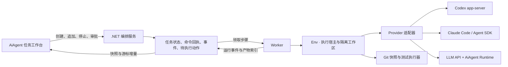
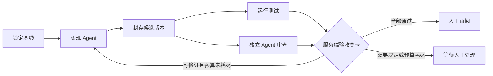

# AiAgent 多 Agent 编程工作台 · 产品原型与架构

2026-11-23 · 设计稿。首版建议面向已登记 Git 仓库的内网开发团队。

## 1. 这能做成什么产品

可以。`Server → Env → Codex CLI / Claude Code / LLM API` 给出了执行骨架。在服务端补上**任务编排、后台调度和运行记录**，在执行环境里补上**隔离工作区和 Provider 适配器**，就能让多个 Agent 围绕同一项代码任务工作。

用户交付的是**目标和验收条件**，例如「修复订单状态筛选遗漏，保留原有排序，加回归用例」。AiAgent 自动改代码、跑验证和审查，交付一份带 Git diff 和验证证据的候选变更。用户可以关页后回来查看，也可以在执行中选中某个 Agent 补发指令，在最终审阅时决定是否交付。

起步用**一台执行主机、一个仓库、一个写入 Agent、一个独立审查 Agent**。这能先验证多 Agent 协作。多机阶段再将任务派到不同 Env，以增加吞吐量或满足工具链要求。同机和多机沿用同一套任务、事件和产物语义。

## 2. 用户看到的工作台

入口建议放在项目页的**新建代码任务**。创建表单只要求选择仓库和基线分支，填写目标与验收条件。模板默认用「实现 → 验证与审查 → 人工审阅」，高级设置可选执行环境、角色使用的 Provider 和时限。提交时由服务端解析并记录基线 SHA，回执返回稳定任务编号。

### 任务详情线框

```text
修复订单状态筛选                       正在实现                [停止任务]
orders · main @ 53d8a21 · 实验执行机

步骤                         运行记录                          任务资料
✓ 准备工作区                 10:21  已锁定仓库基线              [目标与验收]
● 实现 · Codex               10:22  正在修改筛选逻辑            [文件变更]
○ 验证 · 构建执行器           10:23  已收到追加指令              [验证结果]
○ 审查 · 独立 Agent                                             [审查意见]
○ 人工审阅

发送给 实现 · Codex
[ 筛选修复后，保留旧的列表排序，并加一条回归用例。               ]
[排到下一轮]  [追加到当前轮]  [停止本步骤]
```

任务列表展示目标、项目、当前步骤、最近活动和待人工处理项。详情页默认停在当前活动步骤，用户可以点任一步查看消息、命令摘要和产物。在审阅阶段，主操作换成**批准此版本**或**退回修改**。页面直接显示验证成功、失败或未运行，以及对应候选版本。

### 一次完整体验

1. 开发者提交订单筛选任务。服务端保存目标和基线，在独立工作区启动 Codex。
2. 开发者看到 Codex 正在改筛选逻辑，点「追加到当前轮」补充排序约束。界面先显示「待投递」，收到 Provider 回执后显示「已送达当前轮」。
3. 开发者关页。实现完成后，Worker 封存候选版本。测试执行器和审查 Agent 分别读取这个版本并并行工作。
4. 若回归测试失败，服务端把失败用例和审查意见一起交回实现步骤，开启一次有预算的修订。新版本重新验证和审查。
5. 开发者重新打开任务，直接看到当前候选版本的 diff、通过的测试、未覆盖的检查和审查意见。批准后可通过现有交付入口推送独立任务分支。主分支合并继续走仓库自己的审阅流程。

## 3. 架构与任务编排



| 层 | 职责 |
| --- | --- |
| **Server** | 验权，维护任务、依赖、并发与预算，受理人工命令，记录版本与交付状态。工作流模板由代码驱动，Agent 产出计划、代码和审查意见。 |
| **Worker** | 领取步骤，准备资源，驱动 Provider，执行 Git 和测试，回报事件，协调暂停和进程回收。首版可作为现有 .NET 应用内的 `BackgroundService`。 |
| **Env** | 表示一套可执行环境及其工作区根目录、隔离策略、工具链和可用 Provider 实例。首版固定在一台宿主，多机时 Worker 按 Env 注册。 |
| **Provider 实例** | 绑定具体引擎、配置和认证来源，探测可用能力，翻译启动、回复、停止、续接与运行事件。核心编排读取能力，前端据此呈现操作。 |
| **运行时** | Codex 和 Claude Code 自带工具循环。接普通 LLM API 时由 AiAgent Native Runtime 负责上下文、工具调用、权限、迭代与停止条件，再映射到同一运行协议。 |

### 步骤之间通过版本和产物交接



- **任务**保存目标、验收条件、仓库、基线 SHA、权限和预算。**步骤**保存角色、依赖和输入。**执行尝试**保存本次 Env、Provider 实例、启动时间、终态和原生会话引用。修订或手工重试创建新尝试，保留历史。
- 一个任务同一时刻只授予一个写入者。实现 Agent 使用服务端创建的独立克隆。实现步骤结束后，Worker 将改动封存为本地候选提交。测试从该提交创建可写副本，审查以只读方式读取同一版本的源码和 diff。两者都无法改动候选提交。
- Agent 交接内容包括目标、验收条件、基线 SHA、候选 SHA、变更摘要和相关产物引用。跨 Provider 依赖这份材料开启新执行。原生会话续接依赖原实例及其会话数据，留在可访问该数据的环境内。
- 验证关卡使用真实命令的退出码和报告。审查 Agent 交付结构化意见与文件位置。测试和审查结果必须指向同一个候选版本。时间、并发及修订次数由服务端限制。首版可把自动修订上限设为一次，耗尽后等待人工决定。

## 4. 运行中怎样插入 Prompt

| 用户操作 | 实际效果 |
| --- | --- |
| **排到下一轮** | 将指令持久化到指定步骤。当前轮结束后，先处理已排队输入再封存步骤产物。步骤已封存时，提示开修订。 |
| **追加到当前轮** | 发送给选中的活动步骤与执行尝试。服务端校验目标仍活动、能力可用，再通过适配器投递。当前轮已经结束时提示用户可排队或开修订。 |
| **调整任务要求** | 更新任务要求版本，挂起受影响的后续步骤。正在执行的步骤由用户选择追加约束，或停止后从已知检查点继续。需要额外路径权限或凭据时重新授权。 |
| **停止步骤或任务** | 界面先显示「停止中」。冻结相关后续调度，向运行时发停止并确认活动进程退出。保留日志和可审阅的已有改动。 |
| **批准版本或退回** | 批准绑定候选版本和验证记录。退回后创建修订，旧验证和审批留在旧版本。 |

每条追加都记录发送人、目标步骤、尝试编号和投递结果。状态显示「已登记」「已送达当前轮」「目标轮已结束」或「投递待确认」。用户可从实际行为和 diff 核实约束是否采纳。投递超时且结果未知时，保留原记录供核对。审批和 Agent 提问提供独立响应控件，关联原请求编号。服务端分别校验查看、介入和交付权限。

| Provider | 原型采用的交互 |
| --- | --- |
| **Codex app-server** | 首接。使用 `turn/steer` 和 `expectedTurnId` 定向追加。停止时区分 `turn/interrupt` 的请求回执与随后的轮次终态。 [Codex App Server](https://learn.chatgpt.com/docs/app-server#steer-an-active-turn) |
| **Codex exec / Claude Code** | 接入时先提供平台排队。Claude 可用 Agent SDK 流式输入，T3 已有当前轮追加的实现可参考。用部署的 CLI/SDK 版本验证输入接收时机、目标轮校验和中断确认，再开放对应按钮。 [Claude Agent SDK 流式输入](https://code.claude.com/docs/en/agent-sdk/typescript#query) · [T3 的 Claude 适配器](https://github.com/pingdotgg/t3code/blob/0bb6eaa546c91915efbd3f092088c694f3949709/apps/server/src/orchestration-v2/Adapters/ClaudeAdapterV2.ts#L12838) |
| **LLM API + Native Runtime** | 后续接入。在运行时实现可控的消息注入点，例如下一次模型调用前或工具调用完成后。能力声明须反映实际生效点。 |

## 5. 后台执行、恢复和交付

- **执行生命周期由服务端持有。** 提交事务写入命令回执、任务状态、事件和待执行动作。Worker 独立领取。浏览器关闭只关闭订阅。重连时先读任务快照，再按事件游标补增量。事件保存人、步骤、Env、Provider、时间与产物关联，长日志、报告和 diff 则保存为受授权的产物。
- **请求去重和执行恢复分别处理。** 同一个 `command_id` 携带相同内容时返回原回执，携带不同内容时拒绝。Worker 失联时先尝试核对原生执行、进程或已封存产物。确定未启动可重新领取。结果未知则挂起为「需要确认」，阻止下游和重复写入。原生 session 能续接时可以在已确认的检查点开启下一次尝试。
- **执行权限由环境约束。** 独立克隆解决 Git 改动隔离。Agent 与测试进程还需要受限制的 OS 身份或容器、工作目录和网络权限。Provider 登录材料按实例管理，执行测试的进程只拿所需配置。仓库内容、工具输出和产物都按项目权限访问，仓库内文本无法授权执行、追加路径权限或扩大可读数据范围。
- **交付以证据对应的版本为准。** 允许修改和运行测试的权限授予隔离环境。Git 交付由服务端持有单独权限。批准前显示 `base_sha`、`candidate_sha`、变更和验证摘要。推送前复核批准版本、项目授权、目标分支和基线策略。版本变化或基线过期时重新验证后再审阅。首版仅推送独立分支。

### 扩到多个 Env

中心 Server 按仓库可用性、操作系统、工具链、Provider 实例、环境授权和可用并发选 Env。步骤启动后固定宿主，跨机交接用可校验的提交或补丁产物。远端 Worker 通过受认证连接注册和续租，并用领取代次写回结果。旧租约失效后，即使能拒绝它写回数据库，也要先确认旧进程已经停止、或为新尝试分配独立副本。恢复路径沿用已封存版本，原工作目录或外部可写资源仍被占用时继续挂起。多机先验证**新步骤分发和跨环境交接**，运行中进程留在原环境。

## 6. 从 T3 Code 学什么，AiAgent 复用什么

T3 Code 把执行、工作区和 Provider 登录态放在所属环境，用适配器把运行能力与应用编排对接。它还将命令回执、状态和待执行动作持久化，客户端按环境连接与订阅。公开实现已有 Labs 工作流、跨环境委派和新线程选机。AiAgent 可以借鉴这些机制，将项目任务、中心调度、验证证据和 Git 交付连成一个面向团队的流程。 [T3 Code 架构](https://github.com/pingdotgg/t3code/blob/main/docs/internals/overview.md) · [Provider 边界](https://github.com/pingdotgg/t3code/blob/main/docs/internals/providers.md) · [工作流](https://github.com/pingdotgg/t3code/blob/main/docs/internals/workflows.md) · [远程环境](https://github.com/pingdotgg/t3code/blob/main/docs/user/remote-access.md)

| AiAgent 现有能力 | 原型落点 |
| --- | --- |
| 普通 Codex 已有排队、原生追加、会话绑定和命令回放。执行仍关联在线请求，`StartNext` 依赖内存里的等待请求。 | 复用 Codex 进程控制和投递语义。新代码任务使用持久化队列，由后台 Worker 领取。 [投递机制](chat-message-delivery.md) · [当前队列实现](../backed/Services/Chat/Orchestration/ChatDeliveryService.cs) · [后台投递设计](chat-codex-background-delivery.md) |
| 当前工作区已经有 Provider Driver / Instance 的初步实现，目前主要落在 Codex 默认实例。 | 沿用 Driver 与 Instance 的区分，将启动、控制、事件与能力探测组合成运行适配边界。 [Provider Registry](../backed/Services/Chat/AgentProviderRegistry.cs) · [Provider 接口设计](aiagent-provider-driver-design.md) |
| 代码库养护已具备独立克隆、后台调度、构建验证、变更集和逐次审批推送。 | 先用养护执行路径做单仓库实验，复用工作区准备、快照及交付校验。现有养护副本和接口有专属规则，接入新任务时通过明确的来源和版本校验复用。 [养护实施](repository-maintenance-implementation.md) · [Git 交付源码](../backed/Services/Git/GitWorkspaceService.Maintenance.cs) |
| `RunCoordinator` 和运行事件存储已有运行状态基础。 | 复用能够区分运行与事件的表示，根据代码任务补步骤依赖、产物版本和重连读模型。 [运行与变更集设计](agent-run-recovery-capabilities-changesets-design.md) |

## 7. 按什么顺序做，如何验收

| 阶段 | 实现内容 | 可现场验收的结果 |
| --- | --- | --- |
| **第一段 · 单 Agent 打通闭环** | 现有 .NET API + 数据库 + 一个后台 Worker。固定 Env 和 Codex app-server，提供任务详情、停止、原生追加、diff 和批准。选择一个测试仓库走通。 | 提交后关页再打开，任务继续且可以补看事件。重复提交只出现一个任务。运行中追加可见回执。候选版本、实际测试和审批可以对应。 |
| **第二段 · 两个 Agent 协作** | 固定模板中加入独立审查 Agent，测试和审查并行读同一候选版本。按结果和预算自动修订。审查可先使用独立 Codex 会话。 | 两项步骤在时间线上可分别观察。用例失败触发修订，修订后重新验证。审查 Agent 无法写入候选。故障或停止时，下游不会误启动。 |
| **第三段 · 异构 Provider 与多机** | 接入 Claude，发布能力探测；再加远端 Worker、容量调度、租约与产物传递。确有 API 模型需求时，把 Native Runtime 加进来。 | 两台机器上的步骤在一条任务时间线里汇合。拔掉 Worker 后状态显示待确认，旧尝试不能覆盖新状态。跨机验证仍能指向同一候选版本。 |

首个演示用订单筛选任务。预置一条失败的回归用例，运行中追加排序约束，关页再重连，最后检查修复是否同时满足筛选和排序。再在候选版本变化后尝试用旧审批交付，服务端应拒绝。用同一批任务比较「单 Agent + 测试」和「实现 Agent + 独立审查 + 测试」的验收通过率、有效审查发现、人工介入次数、耗时和可获取的用量。用结果决定默认在哪些任务启用审查 Agent。

本稿基于 AiAgent 工作区 `3af2edfc` 附近的代码与在途改动、T3 Code 本地 `0bb6eaa5` 和公开文档。线框、工作流和接口边界是拟议设计。实际 CLI 版本兼容性、断线后的进程行为和隔离策略列入原型开发验收。
