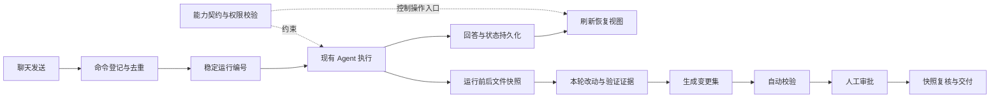
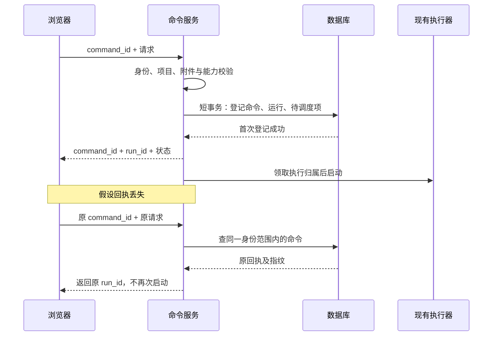
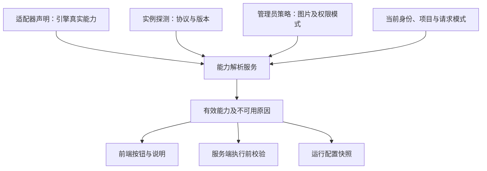
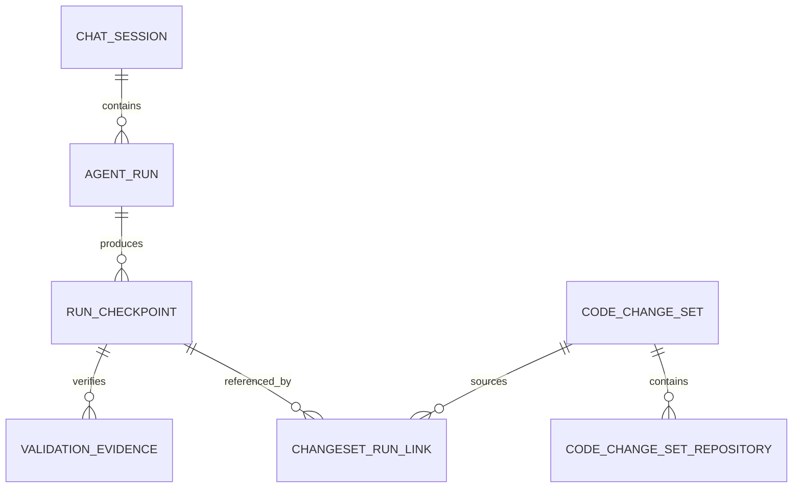
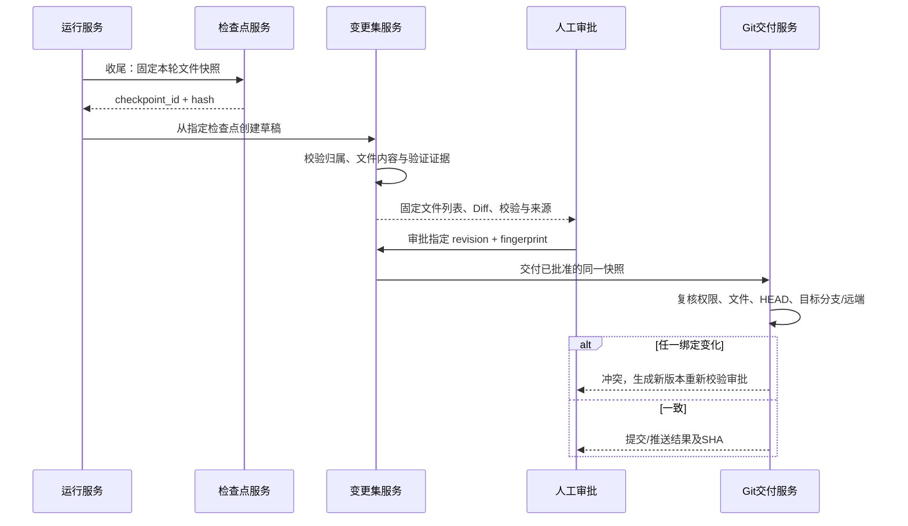

# 命令去重、Agent 能力契约与运行变更集：实施设计

日期：2026-11-11。状态：供评审的实施方案，尚未实现。本文根据当前 AiAgent 代码核对，不要求迁移 T3 Code 技术栈。

## 1. 最终使用起来是什么样

假设你在聊天里要求“修复登录页面”：

1. 点击发送后，服务端返回一个稳定的运行编号。
2. 网络超时后重试，仍定位到这次运行；已经接受的请求不会再次启动 Agent。
3. 刷新页面，读取已保存的回答、运行状态与本轮文件改动。若执行已中断，明确显示中断，用户决定是否继续。
4. 页面根据实际 Agent 能力显示“继续原会话”“查看改动”等按钮，并说明不支持的操作。
5. 本轮结束后可查看修改文件和验证证据，点击“生成变更集”，进入现有代码交付审批。
6. 审批以后代码再次变化，原审批不能继续交付，必须形成新版本并重新校验审批。



这里的“运行”指 AI 的一次执行，不是 `ChatRuntimeService` 管理的应用预览进程。两者使用不同编号与生命周期。

## 2. 当前有哪些基础，缺口在哪里

| 已核对代码 | 当前实现 | 本次需要补的内容 |
| --- | --- | --- |
| `Services/AgentRuntime/RuntimeRequestFactory.cs` | 每次 Create 新建 RunId、TurnId | 同一逻辑请求沿用稳定标识 |
| `Services/AgentRuntime/RunCoordinator.cs` | 内存字典拒绝重复 RunId，保存运行状态和事件 | 持久化命令回执、崩溃对账、重复请求返回原运行 |
| `Services/AgentRuntime/AgentRunStore.cs` | 运行账本、事件序号、脱敏元数据 | 当前事件 Payload 中正文为空，不能直接回放完整回答；需另建受控输出投影 |
| `Services/AgentRuntime/NativeToolClaimStore.cs` | 按用户、会话、TurnId 和调用指纹登记工具执行 | 保留现有保护，补充结果未知的处理；不能把它当完整任务恢复 |
| `Services/Chat/ChatOrchestrator.cs` | Codex、DSH 独立分流；Native runtime 受配置开关控制 | 统一入口登记命令，兼容现有引擎与旧 AgentLoop |
| `Services/Chat/Codex/CodexChatService.Goals.cs` | GoalJson、原生 thread 恢复、版本检查；断线暂停 | 映射到统一运行视图，保留原生目标调度和显式恢复 |
| `Services/AgentRuntime/RuntimeContracts.cs` | IRuntimeEngine、上下文能力快照 | 新增“引擎支持哪些操作”的契约；现有能力快照主要是本次上下文 |
| `Services/CodeDelivery/CodeDeliveryAppService.cs` | 自动 Git 校验、人工审批、交付前快照复核 | 当前按项目仓库扫描，缺少运行来源和固定检查点绑定 |
| `Entities/CodeRepository/AiCodeChangeSet.cs` | 项目、任务、审批、仓库快照 | 关联 RunId、检查点与证据版本 |
| `front/components/chat/ChatStreamProvider.tsx` | 同一浏览器 streamId 重试，普通错误 20 秒重试；目标不自动重发 | streamId 不是服务端幂等保证，改为先查询回执再恢复订阅 |

**实施原则：复用账本和审批链路，在入口、存储和适配器之间补协议，不把全部执行逻辑重写一遍。**

## 3. 命令去重与运行恢复怎么改

### 3.1 先分清四类编号

| 编号 | 含义 | 生命周期 |
| --- | --- | --- |
| command_id | 用户的一次操作，如开始、暂停或显式继续 | 传输重试保持不变；改变操作生成新编号 |
| run_id | 一次实际执行尝试 | 服务端分配；同一命令重复到达返回原编号 |
| turn_id | 逻辑用户请求边界 | 在同一请求的传输重试中保持稳定，供工具去重使用 |
| sequence | 某次运行可补发事件的顺序 | 服务端分配，单调递增 |

显式继续使用新的 command_id、新的 run_id，并通过 parent_run_id 关联前次运行；是否沿用底层 thread 取决于能力和权限绑定。传输重试绝不等于显式继续。

### 3.2 请求接受流程

在现有聊天请求 DTO 添加可选 `command_id`，HTTP 与 WebSocket 都在完成身份和资源授权后进入 `AgentCommandService`。新前端必须发送该字段；旧客户端兼容请求只能获得旧有保证，不能宣称跨重试去重。

请求指纹覆盖正文、附件 ID 与内容版本、项目/会话、模型与推理等级、权限模式、目标动作及 expected_version、技能完整版本、已选择资料快照。服务端计算规范化指纹，不信任浏览器提交的哈希。凭据、绝对路径不放入公开回执。



数据库用唯一键或确定性主键实现竞争保护，不能先查后插依赖进程锁。同一 command_id、同一内容返回原回执；同一编号改了内容返回 409；另一用户不能借编号查询或复用运行。

新增命令表建议保存：服务端身份、会话/项目、command_id、request_hash、run_id、command_type、接受状态、创建时间。新增执行待办表保存调度状态和执行归属，命令、运行、待办同事务提交。所有新增普通实体字段按仓库约定显式可空；主键及唯一约束的实际迁移、历史兼容另行验证。

### 3.3 崩溃窗口不能靠“重试”蒙过去

| 崩溃位置 | 能确认的事实 | 处理 |
| --- | --- | --- |
| 登记事务之前 | 尚未接受 | 相同命令可以重新提交 |
| 事务提交，待办尚未领取 | 已接受，未派发 | 当前有效在线请求仍存在时可派发；在线模式请求已失效则标记中断，等待用户操作 |
| 已记录 dispatching，但启动回执没落库 | 可能已启动 | 进入结果未知，不重新启动；尝试查询原供应商执行 |
| 工具已执行，结果未保存 | 副作用可能已发生 | 保留 claim，停止自动重放，提供核对信息 |
| 已完成，客户端没收到结果 | 已有持久化结果 | 返回原结果 |

Outbox 只解决“接受后丢失待执行记录”，不保证外部进程和副作用恰好执行一次。第一版目标是**平台不重复派发，不能确认时停下来核对**。只有供应商提供可靠幂等键或可查询执行标识，才扩展自动恢复。

第一版保持单 API 实例。数据库执行版本、owner_epoch 和条件更新用于拒绝旧 worker 的迟到写入；worker 心跳过期不意味着可以重新执行未知操作。多实例还需要端到端租约与外部执行 fencing，单加租约字段并不足够。

### 3.4 恢复视图和继续执行分开

**恢复视图**：拿回已保存的状态、回答与文件改动，不调用模型。

**重新订阅**：读取当前运行后续事件，不产生新运行。在线模式断线仍按原规则取消或暂停，重新订阅不会悄悄复活它。

**继续执行**：用户显式操作，重新校验身份、项目、模型、权限、工作区和版本后创建后继运行；有供应商 thread 时恢复原 thread，无可靠能力时仅允许明确的新任务。

拟新增接口，最终路由按现有 Furion 约定验证：

| 接口 | 用途 |
| --- | --- |
| `GET /api/v1/agent-commands/{commandId}` | 查询当前用户的命令回执，供发送超时后对账 |
| 现有 `GET /api/v1/agent-runs/{runId}` 扩展 | 返回执行状态、收尾状态、输出快照、版本及 snapshot_sequence |
| `GET /api/v1/agent-runs/{runId}/events?after_sequence=N` | 分页补发已提交事件，返回 next_sequence、has_more |
| `POST /api/v1/agent-runs/{runId}/resume` | 支持该能力时显式继续，携带新 command_id 和 expected_version |

目标模式继续优先沿用原 goal 请求与 expected_version；上述 resume 服务内部复用同一目标控制逻辑，不增加第二套目标启动入口或 `turn/start` 循环。

快照和 `snapshot_sequence=S` 必须来自一致的已提交投影，随后只消费 `sequence>S`。正文增量、状态更新和游标推进需要同一提交边界；序号有保留缺口时必须明确让客户端重新加载快照，不能跳过丢失内容。

保留现有诊断事件脱敏规则，另建用户隔离的输出投影，只保存本就允许进入聊天历史的回答/工具展示内容；不复制原始供应商协议、内部推理、凭据或任意工具输出。最终消息用稳定 run_id 关联并唯一写入，防止完成结果重复进入历史。短期增量被清理后仍能读取正文快照。

执行状态、连接状态、收尾状态分别表示：

```text
execution_status: queued / dispatching / running / completed / interrupted / unknown / failed / cancelled
connection_status: connected / reconnecting / disconnected （客户端状态）
finalization_status: pending / collecting / ready / failed
```

回答成功但 Diff 收集失败时：execution=completed，finalization=failed，允许单独重试收集，不再次调用模型。新执行状态需同步扩展 RunStateMachine、DTO、前端投影和终态判断。

### 3.5 具体改动文件

| 文件 | 改法 |
| --- | --- |
| `backed/Dtos/Chat/ChatDtos.cs` | 增加 command_id 等兼容字段 |
| `backed/Services/Chat/ChatAppService.cs` | HTTP/WS 请求进入共同命令登记流程；协议层保持轻量 |
| `backed/Services/Chat/ChatOrchestrator.cs` | 统一登记后分流，覆盖 Native 开关关闭的旧链路和 Codex/DSH |
| `backed/Services/AgentRuntime/RuntimeRequestFactory.cs` | 接收服务端已分配运行标识，不在重试时重新随机生成 |
| `backed/Services/AgentRuntime/RunCoordinator.cs` | 接受既有运行、条件状态更新、执行归属、终态与输出一致性 |
| `backed/Services/AgentRuntime/AgentRunStore.cs` | CopyNew 独立数据库客户端、短事务、快照及分页事件读取 |
| `backed/Services/AgentRuntime/RunStateMachine.cs` | 增加中断/未知及合法转换，禁止未知状态自动回到执行 |
| `backed/Services/AgentRuntime/AgentRunAppService.cs` | 扩展查询与补发，所有读取重验会话及当前项目授权 |
| `backed/Services/Chat/Codex/CodexChatService.Goals.cs` | 仅接入运行标识、状态投影；保留 GoalJson 和原生恢复规则 |
| `backed/Entities/Chat/AiAgentRun.cs`、`AiAgentRunEvent.cs` | 增加版本、关联和可补发序号约束，兼容历史空值 |
| 新增 `AgentCommandService.cs`、`AgentRunRecoveryService.cs`、命令/待办/输出投影实体 | 分别承载幂等接受、启动对账、受控回答恢复 |
| `backed/Services/Settings/ModelSchemaInitializer.cs` | 按现有启动顺序加表、可空补列和索引；失败即终止 |
| `front/lib/chat-api.ts`、新增 `agent-run-api.ts` / `agent-run-types.ts` | 统一请求编号、回执、快照及补发接口 |
| `front/components/chat/ChatStreamProvider.tsx` | 20 秒重试先查回执；已接受则同步，明确未接受才原命令重发；目标保持不自动续跑 |

前端只保留不含正文和凭据的待确认命令索引，按登录用户隔离并在登出时清理。刷新遇到发送结果未知时先查询；找不到回执也不能凭空重新构造带附件/技能的旧请求。

## 4. Agent 能力契约怎么改

### 4.1 要解决的具体问题

目前界面与后端容易分别判断“是不是 Codex”“是不是某个 Profile”。随着恢复和检查点增加，这些分支会越来越多。改为后端给出**当前引擎实例、当前模型与当前权限下的可用操作和原因**。

`RuntimeCapabilitySnapshot` 继续表示本次上下文范围；新增 `AgentCapabilities` 表示执行器的功能，两者不混用。



有效能力 = 引擎支持 ∩ 实例已确认 ∩ 管理员允许 ∩ 当前用户/项目允许。模型目录仍由现有策略服务决定，能力接口不额外开放模型或权限。

### 4.2 契约建议

```json
{
  "schema_version": 1,
  "provider_kind": "codex-app-server",
  "provider_instance_id": "opaque-instance-id",
  "capability_revision": "server-generated-revision",
  "operations": {
    "observe_run": { "available": true },
    "resume_thread": { "available": true },
    "resume_inflight_turn": { "available": false, "reason_code": "not_verified" },
    "goal": { "available": true },
    "background_execution": { "available": false, "reason_code": "online_only" },
    "workspace_checkpoint": { "available": false, "reason_code": "workspace_not_isolated" }
  },
  "sandbox_modes": ["read-only", "workspace-write"],
  "image_input": { "available": false, "reason_code": "policy_disabled" }
}
```

以上仅是某个假设实例的响应示例，不代表当前 Codex 实际开放的模式。`resume_thread` 表示恢复供应商会话，不表示从崩溃指令继续；`resume_inflight_turn` 必须单独验证。

| 能力 | 第一版判断方式 |
| --- | --- |
| 运行观察与输出恢复 | 平台持久化链路接入并通过验收后开放 |
| Codex 目标 | 原生 app-server 实例、功能开关及协议确认同时满足 |
| Exec Profile 图片 | 现有 supports_image_input 与原图总开关同时满足 |
| 普通 Codex 崩溃续跑 | 当前普通 thread 为 ephemeral，默认不支持 |
| Native 工具副作用恢复 | 已有 claim 不等于可续跑，默认不自动重放 |
| 检查点 | 平台工作区服务提供，不能因为模型“会改文件”就开放 |
| 回退与后台执行 | 第一版不开放，分别设计写入保护和后台授权后再接 |

未知、探测失败、协议不兼容都返回不可用及原因，不用模型名称猜测。恢复时重新计算权限；旧快照用于审计，不恢复已被撤销的权限。

### 4.3 代码怎么组织

| 文件/模块 | 改动 |
| --- | --- |
| 新增 `Services/AgentRuntime/AgentCapabilities.cs` | 版本化 DTO、能力枚举及原因码 |
| 新增 `AgentCapabilityService.cs` | 合并声明、探测、策略和当前授权 |
| `RuntimeContracts.cs`、`NativeAgentRuntime.cs` | 引擎声明接口及 Native 实现；不承担 HTTP |
| 新增 Codex/DSH capability adapter | 包装现有服务，分清 app-server、exec Profile 和 Harness |
| `Services/Chat/AgentProviderAppService.cs` 与 `Dtos/Chat/AgentProviderDtos.cs` | 增加可供当前聊天查询的能力投影或独立能力端点 |
| `ChatOrchestrator.cs` | 执行前统一按能力校验；第一阶段不强迫 Codex 迁入 Native coordinator |
| `front/lib/` 对应 API 与类型 | 消费明确能力和原因，拒绝未知 schema 版本 |
| `ChatGoalPanel.tsx`、聊天菜单及模型选择处 | 根据能力展示入口，恢复焦点时更新，忽略旧项目响应 |

实现时先做只读能力服务，再逐项替换现有硬编码判断。服务端校验始终存在，隐藏按钮不是权限控制。

## 5. 运行改动与变更集怎么关联

### 5.1 为什么不能“执行结束就 git diff”

当前普通变更集校验按项目扫描仓库。仓库里可能有用户之前的未提交文件、另一个会话的改动或 AI 中途产生的提交。只看结束时 Diff，无法证明都属于本轮。

第一版采用两个清晰等级：

| 场景 | 可提供的能力 |
| --- | --- |
| 共享工作区或开始时有未知改动 | 显示运行期间观察到的变化，标记归属无法确认；禁止自动声称本轮独占或一键生成精确交付 |
| 经验证的干净、独占工作区 | 前后快照形成可审阅检查点，可生成绑定本轮的变更集 |

**建议先在干净且独占的代码任务工作区落地精确交付。** 不清空、不 stash、不回退用户原有改动。已知项目其他仓库变更也不能自动卷进本轮变更集。

平台内仓库写入可使用统一仓库锁，但锁挡不住外部编辑器或终端。原目录运行即使拿到平台锁，归属仍只能标记为“观察到”；可靠独占应使用服务端创建的受控 worktree/副本，绑定仓库、用户和运行，路径由服务端生成并验证链接边界。多仓库按固定顺序取锁；第一版不提供检查点回滚。

### 5.2 前后快照是什么

开始时固定：仓库 ID、基线 HEAD、分支、工作区实例 ID、初始受控文件清单与内容哈希、权限/策略版本。

结束时固定：最终文件清单与内容哈希、增加/修改/删除/重命名结果、二进制摘要、允许保留的 Diff 与验证结果。内容保存在非公开的用户/项目隔离存储，通过临时目录完整写入后原子发布；路径越界、链接逃逸、敏感配置、体积超限应阻断交付收集，并明确不完整，不能悄悄漏文件后算成功。

比较的是起始与最终文件树，既覆盖已提交变化，也覆盖暂存、未暂存和允许纳入的未跟踪文件。运行失败或取消也可以保留检查点，但状态不能伪装成功。

### 5.3 数据关联



建议新增：

- `AiAgentRunCheckpoint`：RunId、RepositoryId、WorkspaceId、BaseHead、before/after manifest hash、CheckpointHash、归属等级、收集状态、受控内容引用。
- `AiAgentRunValidation`：CheckpointId、验证项、工具/脚本版本、输入快照哈希、退出码、起止时间、脱敏结果引用。
- `AiCodeChangeSetRunLink`：ChangeSetId、RunId、CheckpointId、CheckpointHash。使用关联表支持多仓库与后续多轮整合，第一版限定同用户/同项目且无歧义。
- 变更集增加来源类型、版本及审批绑定指纹；仓库记录增加检查点/工作区来源，所有新增普通字段显式可空，旧变更集继续走旧路径。

验证证据必须指向固定快照。模型说“测试通过”只能作为说明；平台实际执行并记录退出码的检查才作为验证证据。现有 Git 交付检查也不能改名声称完成了编译或测试。

### 5.4 固定快照进入审批



审批指纹建议覆盖：变更集版本、检查点、基线 HEAD、目标仓库/分支/远端身份、完整文件清单与内容哈希、适用校验策略及证据。审批接口接收 expected_revision 和 expected_fingerprint；服务端重新计算并比较。不能只在前端显示一个哈希。

交付读取固定快照对应的受控工作区，不能再扫描项目所有仓库或把当前整个脏目录提交。若复用现有 `CommitAndPushAsync`，必须先确认其提交范围和锁覆盖范围；需要改成接受固定快照/明确文件范围的内部方法，复核与提交持有同一仓库锁。

受控 worktree 的交付需新增明确的交付来源类型，不能把临时目录塞进原仓库名称字段。原工作目录交付、运行工作区交付、养护副本交付分别路由；保持养护变更集不得从普通接口交付的现有规则。

多仓库交付按仓库记录结果，不能假设跨仓库原子推送。推送超时进入结果待确认，先查已记录提交与远端状态，不能因重试再提交一份；已有本地提交应复用，结果和命令输出继续返回用户。

### 5.5 具体改动文件

| 文件 | 改法 |
| --- | --- |
| 新增 `Services/AgentRuntime/RunCheckpointService.cs` | 独立收集前后快照，收尾失败可重试 |
| 新增 `Services/CodeRepository/AgentRunWorkspaceService.cs` | 工作区分配、独占绑定、路径/链接检查；先覆盖可控代码任务 |
| `RunCoordinator.cs` 与 Codex 执行适配处 | 运行前记录基线，终态后触发收尾；收尾错误不覆盖模型结果 |
| 新增检查点、验证证据、运行关联实体 | 持久化不可变版本和来源 |
| `backed/Entities/CodeRepository/AiCodeChangeSet.cs` | 增加来源/版本/审批绑定信息 |
| 新增 `Services/CodeDelivery/CodeChangeSetService.cs` | 从现有 Controller 提取创建、校验、审批、交付业务，新增从检查点创建 |
| `Services/CodeDelivery/CodeDeliveryAppService.cs` | 保留路由与身份处理，调用领域服务；新增来源查询/创建入口 |
| `Services/Git/GitWorkspaceService.cs` 及其接口/仓库 Git 服务 | 复用已有校验、补固定快照交付和锁内复核；不直接复用全仓扫描做运行归属 |
| `backed/Dtos/CodeDelivery/CodeDeliveryDtos.cs` | 返回来源运行、检查点、版本、证据及归属等级 |
| `front/lib/code-delivery-api.ts` / `code-delivery-types.ts` | 同步接口和类型 |
| `front/components/code-delivery/CodeDeliveryPage.tsx` | 增加运行来源、固定 Diff、证据与快照失效提示 |
| 新增聊天 `AgentRunPanel.tsx` / `AgentRunChangesPanel.tsx` | 展示恢复状态、本轮改动、验证及生成变更集入口 |

## 6. 页面大概长什么样

```text
运行 #R1024                         执行：已完成
                                   改动收集：已就绪
连接：已恢复      来源：Codex app-server

[回答] [本轮改动 3] [验证 2] [运行记录]

本轮改动：受控独占工作区，基线 a12bc34
  M front/components/login/LoginForm.tsx
  M front/lib/auth-api.ts
  A front/tests/login-error.test.ts

验证：类型检查通过；登录错误回归通过
检查点：CP208 / 版本 1

[查看 Diff] [生成变更集]
关联变更集：#56 待审批 → [打开审批]
```

以上文件名和测试为界面示意。共享目录则显示“检测到运行期间变化，归属待确认”，解释阻断原因。切换项目或会话取消旧查询；旧响应不能覆盖新运行面板。

## 7. 建议分四个阶段交付

| 阶段 | 范围 | 可见成果 | 完成标准 |
| --- | --- | --- | --- |
| A | 公共入口命令登记、稳定运行 ID、未知状态对账 | 重复发送有原回执；失败原因可解释 | 并发重复请求只派发一次，崩溃窗口不盲重启 |
| B | 输出快照、事件补发、能力接口及前端恢复 | 刷新能拿回已保存内容，按钮与实际能力一致 | 无重复正文，游标过期可恢复，越权拒绝 |
| C | 受控工作区、不可变检查点、验证证据 | 看懂本轮到底改了什么 | 用户旧改动不纳入，收尾失败不丢回答 |
| D | 运行来源变更集、审批版本及固定快照交付 | 从运行进入现有人工审批 | 审批后变化必阻断，提交和推送可对账 |

先打通一条受控代码执行链路，公共命令层覆盖其他入口；尚未接入输出/检查点的引擎明确返回不支持。后台持续执行、多实例调度、检查点回滚和 KunBuddy 多端共享不包含在首版，不在重构中改变现有断线语义。

## 8. 验收要针对故障，不只测成功

| 场景 | 必须看到的结果 |
| --- | --- |
| 两个连接同时提交同一命令 | 一个运行，同一回执 |
| 同一编号换正文/附件/目标版本 | 409，不调用引擎 |
| 接受回执丢失再重试 | 回到原运行 |
| 登记后重启、派发中重启、工具执行后重启 | 分别按明确阶段对账；未知副作用不重放 |
| 已完成但聊天消息写入重试 | 只产生一条正式回答 |
| 快照读取期间新增事件 | 序号连续，正文不漏不重 |
| 旧 worker 终态晚到 | 版本/归属不符被拒绝 |
| 用户项目授权撤销后刷新/继续 | 查询与继续都按当前权限处理 |
| 能力探测失败或 Profile 无原图支持 | 前后端均拒绝相应操作 |
| 原目录有用户改动、外部写入或多会话并发 | 不声称精确归属，不混入自动交付 |
| 二进制、重命名、删除、未跟踪及中途提交 | 固定文件树差异正确，超限明确阻断 |
| 回答成功但 Diff 收尾失败 | 回答保留；只重试收尾 |
| 审批后改文件/切分支/改远端 | 原审批无法交付 |
| 推送返回前网络断开 | 查询原提交结果，不重复生成提交 |

使用临时 Git 仓库、本地远端、隔离 SQLite 和协议替身。故障注入保留真实命令层、状态机、存储与投影，统计外部实际启动/工具调用次数。具体实现时同步相关设计文档、README 和 AGENTS 中的实际契约；本次仅新增方案文档，不修改运行行为，也未执行构建或操作真实数据库。
