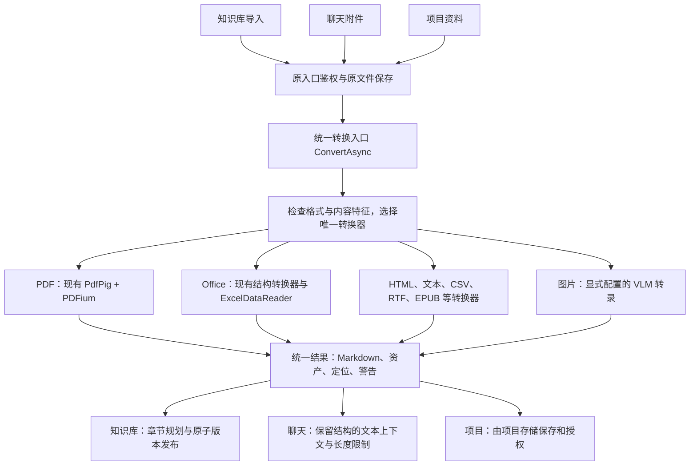

# AiAgent 统一多格式转 Markdown：原理与实施方案

状态：第 1–10 节保留前期原理与设计依据；用户确认后已开始落地，当前实际实现与限制见第 11 节。

建议采用“统一 C# 转换入口 + 各格式专用转换器 + AiAgent 自有产物发布”的方案。借鉴 ElBruno 的组织方式，继续使用现有 PDF 引擎；知识库、聊天附件和项目资料逐步共用转换入口。下面先解释上游原理，再给出针对当前仓库的实施安排。

## 1. 参考范围与核实方式

参考项目：[ElBruno.MarkItDotNet](https://github.com/elbruno/ElBruno.MarkItDotNet)。源码核实日期：2026-11-17；固定提交为 [`8be30418bdfb60aaafcb22640529ffc391391322`](https://github.com/elbruno/ElBruno.MarkItDotNet/commit/8be30418bdfb60aaafcb22640529ffc391391322)，提交时间 2026-11-14。下文“上游当前行为”均指这一固定提交，避免 README 或后续 main 分支变化造成混淆。

本次只核对官方源码与依赖声明，未安装上游包、未运行其测试，未读取用户原书、真实配置或数据库；不据此承诺转换质量优于 AiAgent 当前实现。该提交主项目声明版本 `0.9.4`，目标框架为 `net8.0;net10.0;net11.0`；这是源码事实，不代表已核实 NuGet 当前发行版本或已完成 AiAgent .NET 9 的兼容性验证。[项目声明][up-project]

## 2. 它的基本原理

### 2.1 用统一入口调度各格式转换器

它把不同文件转换为 Markdown 的公共流程集中在 `MarkdownService`，每种格式有各自的转换器。转换器实现 `IMarkdownConverter`：声明能处理哪些扩展名，再接收文件流、扩展名与取消令牌，返回 Markdown 字符串。[入口实现][up-service]、[转换器接口][up-interface]


调用者只需知道“把这个文件转换”，不需要知道 Word 的关系 XML、Excel 的单元格或 PDF 的文字坐标；这些差异放在各自转换器内。统一的是调用方式与结果形式，解析算法仍按格式分别实现。

### 2.2 注册表如何选择解析器

`ConverterRegistry.Register` 将转换器追加到列表；`Resolve` 把扩展名转成小写，选择第一个 `CanHandle` 返回真的转换器。插件通过 `IConverterPlugin.GetConverters` 提供更多转换器，再按同样方式追加。[注册表][up-registry]、[插件接口][up-plugin]

因此，固定提交中的实现有三个需要准确理解的地方：

- 主调度根据扩展名选择，没有在这个步骤自动识别文件签名、OOXML 包类型或正文语义。
- “先注册者优先”，不是后注册自动覆盖；同时注册两个 PDF 转换器，后者可能永远不会被选中。
- 选中一个转换器后发生失败，不会由注册表自动尝试下一个转换器。通用 fallback 链并未在这个主调度中实现。

默认便捷入口 `MarkdownConverter` 和 `AddMarkItDotNet` 注册基础转换器，其中已经包括 PDF 和图片。接入 AiAgent 时不能直接照搬默认注册后再追加自有 PDF 实现，否则会有路由冲突。[默认注册][up-di]、[便捷入口][up-facade]

### 2.3 Markdown 是如何生成的

它主要使用格式本身已有的结构来生成 Markdown。Word、PPT、Excel 本来就有段落、文本运行、表格和顺序信息，解析器读取这些结构后输出 `#` 标题、列表、链接和 Markdown 表格。基础转换并不需要让大模型重新写一遍正文。

PDF 则不同：文字常按绘制位置存储，未必具有“这是第三级标题”“这张图片属于这一段”的语义。上游 PDF 转换器根据文字坐标分行、行距分段、字号和粗体比例推测标题，属于确定性启发式，不能等同于完整恢复原文版式。[PDF 实现][up-pdf]

## 3. 各格式的实际处理方式

以下是固定提交中直接核对到的实现，不将注释或宣传中的格式支持扩大为未实现的能力。

| 格式 | 实际读取与生成方式 | 对 AiAgent 的意义 |
| --- | --- | --- |
| DOCX | `DocumentFormat.OpenXml` 读取正文段落、命名标题样式、编号、文本格式、超链接、表格及脚注，拼成 Markdown。 | 可以参考结构遍历；仍须保留现有自定义标题样式、全文覆盖和资源协议。 |
| XLSX／XLSM | 独立 Excel 包使用 `ClosedXML` 读取工作表及使用区域，首行作为表头，输出格式化后的单元格值并转义竖线。 | 适合表格正文；不能据此宣称覆盖 XLS／XLSB 或导出工作簿全部图表和图片。 |
| PPTX | 独立 PowerPoint 包使用 OpenXML，按 `SlideIdList` 顺序读取每页 shape 文本与备注，保留部分粗斜体。 | 可借鉴备注读取；该实现不能代替现有 PPT 表格提取，未实现整页版式还原。 |
| HTML | 使用 `ReverseMarkdown` 将 HTML 转 Markdown，配置 GFM、移除注释及链接处理；未知标签采用 PassThrough。 | 适合调用专用库，但 AiAgent 仍需明确 HTML 清理、链接和资源处理规则。 |
| PDF | 使用 `PdfPig` 提取词语，根据坐标、行距、字号等组织文本；提供按页输出的流式接口。 | 可以参考文字组织；没有 AiAgent 当前的 PDFium 页面渲染、图片及矢量图裁切链路。 |
| 独立图片 | 基础 `ImageConverter` 返回图片引用、格式和部分格式的像素尺寸说明。 | 这是图片引用和描述性元数据，不是识别图片正文。 |

对应源码：[DOCX][up-docx]、[Excel][up-excel]、[PowerPoint][up-ppt]、[HTML][up-html]、[PDF][up-pdf]、[图片][up-image]。

### 3.1 “支持图片”不等于已经保存可访问的图片文件

该提交的 DOCX 转换器遇到 `Drawing` 时输出 `` 占位，没有同时把关联图片导出为本地文件，也没有输出可供 AiAgent 校验的图片哈希、清单路径和解析版本。基础图片转换器同样会产生约定名称的图片引用，但并不负责把输入流发布到知识库资源目录。[DOCX 的 ProcessRun][up-docx]、[图片转换][up-image]

因此，直接采用上游字符串会出现“Markdown 里有图片语法，但浏览器找不到真实图片”的问题。AiAgent 需要单独完成图片提取、落盘、链接重写和受控访问；PDF 已有的这套能力应继续保留。

### 3.2 AI 扩展与真实 OCR 要分开理解

`AiImageConverter` 确实将图片字节封装成 `DataContent` 交给 `IChatClient`，让模型描述图片和提取可见文字；需要配置模型，不属于基础图片解析自动具备的能力。[AI 图片转换][up-ai-image]

但固定提交的 `AiPdfConverter` 对低文本页只发送页码及已有少量文字的文本提示，没有把该页渲染成图片交给模型；无文字页甚至要求生成预期结构占位。因此它不能作为“真实扫描 PDF OCR 已完成”的依据，也不适合作为 AiAgent L2 原文证据的默认来源。[AI PDF 转换][up-ai-pdf]

AiAgent 应继续将扫描页标记为“尚未 OCR”，保留真实页面图片；后续若增加 OCR，必须读取实际页面像素并把转录结果与来源页绑定，不能用模型猜测补齐正文。

## 4. 上游结果与运行机制的边界

### 4.1 结果是转换结果，不是知识库发布记录

主入口返回 `ConversionResult`，包含 Markdown、来源格式、成功标记、错误消息及可选元数据。`ConversionMetadata` 定义页数、词数和耗时，但主入口所检查的实现只主动填词数与耗时；不能因为存在 PageCount 属性就认定每个格式都返回了页数。[结果模型][up-result]、[元数据][up-metadata]、[入口实现][up-service]

它不直接提供 AiAgent 的 raw 资源 URI、最新解析版本、来源哈希、资产哈希及原子发布状态。上游还有 CoreModel 等结构化项目，但不能将这些概念与 AiAgent 的来源授权及发布协议直接画等号。

### 4.2 流式输出与取消

`IStreamingMarkdownConverter` 允许转换器逐块返回文本。主入口只有遇到支持此接口的转换器才逐块输出，否则先得到完整字符串再返回一个块；这不是所有格式都能边读边转换，也不是自动实现了增量入库。[流式接口][up-streaming]、[入口实现][up-service]

`MarkdownService` 捕获普通异常并转换为失败结果，特意让 `OperationCanceledException` 向上传播。PDF 会在页间检查取消，Excel 在工作表／行间检查，PPT 在页间检查；但所核实 DOCX 正文循环没有取消检查。AI 图片与 AI PDF 的局部降级代码使用宽泛 `catch(Exception)`，可能吞掉取消并返回占位。[入口][up-service]、[DOCX][up-docx]、[AI 图片][up-ai-image]、[AI PDF][up-ai-pdf]

结论：AiAgent 可以参考其分格式调度与组合方式，但不能原样继承所有失败／降级语义。原文解析失败应明确失败，用户取消应停止，不把占位或空字符串视为完整正文。

### 4.3 依赖与复用方式

该提交核心依赖包括 OpenXML、ReverseMarkdown、PdfPig、RtfPipe 和 VersOne.Epub；Excel 另用 ClosedXML，PPT 另用 OpenXML。依赖集中版本管理，直接接整个项目需要额外核对 AiAgent 已有依赖和 .NET 9 的实际还原／编译结果。[主项目][up-project]、[依赖版本][up-packages]

项目采用 MIT 许可证；若后续复制或改写具有实质内容的上游源码，应保留相应版权及许可证说明，第三方依赖按各自许可证处理。本轮仅形成设计说明，没有复制转换器业务实现。[许可证][up-license]

## 5. AiAgent 当前已经具备什么

以下为本轮对当前工作区源码的静态检查；本轮没有重新执行上一轮的测试，也没有把后文方案描述为已实现。

| 位置 | 当前行为 | 需要统一的地方 |
| --- | --- | --- |
| [DocumentParsingService.cs](E:/项目/know-why/AiAgent/backed/Services/Parsing/DocumentParsingService.cs) 与 [CSharpPdfLayoutConverter.cs](E:/项目/know-why/AiAgent/backed/Services/Parsing/CSharpPdfLayoutConverter.cs) | C# PDF 文字／书签／字号／表格提取，PDFium 渲染与图片／矢量图裁切，输出 Markdown、文本、PNG 和哈希；无 Python 主链路。 | 保留为 PDF 专用实现，由统一入口固定分发。 |
| [KnowledgeIngestionService.cs](E:/项目/know-why/AiAgent/backed/Services/Knowledge/KnowledgeIngestionService.cs:239) | PDF、Office、HTML、文本和 VLM 图片各有分支，再进入章节规划和版本发布。 | 将格式转换分支集中到统一入口；原有章节规划与发布继续由知识模块负责。 |
| [OfficeMarkdownConverter.cs](E:/项目/know-why/AiAgent/backed/Services/Parsing/OfficeMarkdownConverter.cs) | 已保留 Word 标题样式继承、正文与表格，PPT 演示顺序与表格，以及 Excel 工作表与空列位置。 | 优先包成转换器复用，按需补齐图片、备注与格式，避免整体替换造成回退。 |
| [ChatFileAttachmentService.cs](E:/项目/know-why/AiAgent/backed/Services/Chat/ChatFileAttachmentService.cs:221) | 有独立的 Office／HTML／PDF 文本提取；Excel 用 ExcelDataReader，支持 XLS、XLSB 等。 | 文档部分接统一入口，保留 Excel 格式覆盖、提取长度、本人附件权限与不可信内容包装。 |
| [CodeRepositoryManager.cs](E:/项目/know-why/AiAgent/backed/Services/CodeRepository/CodeRepositoryManager.cs:829) | 项目文档又有独立的 OOXML、Excel、HTML 与 PDF 转换分支。 | 与知识库共用转换能力，项目保存与授权仍由原项目模块处理。 |
| [KnowledgeParsedDocumentStore.cs](E:/项目/know-why/AiAgent/backed/Services/Knowledge/KnowledgeParsedDocumentStore.cs:24) | 完整正文、章节、PNG、清单和哈希在 staging 写齐后原子发布。 | 继续负责知识库产物生命周期；转换器只生成本次临时产物。 |

当前有一个具体问题需要一并处理：项目 PDF 导入读取临时 Markdown 后，会在 finally 中清理整个转换目录。如果 Markdown 引用了其中的 PNG，保存下来的链接会失效。统一入口必须明确“是否持久保存资产”，不能把临时图片路径直接返回给页面。

另外，转换器内部支持格式与上传入口白名单并不相同。例如知识入库代码有旧 Office 转换分支，但批量导入入口会拒绝旧 Office。实施时应按入口核对真实支持范围，不把内部某个分支存在当作产品已支持。

## 6. 推荐的统一流程



统一转换器只处理“受控输入变成什么内容”，不承担登录身份、知识目录归属、数据库版本发布、RAG 索引或模型摘要。入口先完成授权，结果再交回原模块保存。

### 6.1 接口怎么收敛

建议扩展现有 `IDocumentParsingService` 增加一个 `ConvertAsync`，保留 `ParsePdfAsync` 作为旧调用兼容入口。内部使用多个真正存在的格式转换器；同一种已检测格式只允许配置一个默认处理者，启动时发现冲突即报错。PDF 始终固定走自有实现，不受通用库的注册顺序影响。

请求与结果可以沿用现有契约扩展，下面是设计字段，不是已经新增的代码：

| 对象 | 建议字段与含义 |
| --- | --- |
| 请求 | 受控输入路径、原始名称、受控输出目录、声明 MIME、是否导出图片、显式的 VLM 设置。物理路径由服务端解析，不接受网页自由填写。 |
| 格式检测结果 | 实际格式、扩展名／签名核实结果、所选转换器。OOXML 需要检查 ZIP 内部包结构，不能只见 ZIP 签名就判断为 Word。 |
| 转换结果 | `Ok`、实际 `Engine`、`MarkdownPath`、兼容的 `TextPath`、`Assets`、`Warnings`、`Details` 与错误码。 |
| 定位信息 | PDF 使用真实页数／页号；PPT 使用幻灯片位置；Excel 使用工作表名，不能都伪装成 PDF 页数。 |
| 资产 | 受控相对路径、内容哈希、类型和可选来源定位；PDF 的现有 Page／Kind 字段继续兼容。 |

资产目录由调用方分配，转换器不自行删除。调用方必须等转换真正退出，再发布或清理；取消异常继续向上传递。文本转换不应因为 PDF 原生库未安装就被全局 preflight 阻止，环境检查需区分所需能力。

### 6.2 怎样保留 PDF 能力

PDF 转换器内部直接复用当前 C# 实现，保留书签／字号标题、网格表格、嵌入图片、矢量图区域、旋转与 CropBox 坐标处理，以及扫描页提示。输出引擎继续标记为 `pdfpig-pdfium-layout`。

知识库使用带资产模式，继续输出相对 PNG 链接；聊天使用不导出图片的文本模式。扫描页仍保存真实图像并注明“尚未 OCR”；不借用上游 AI PDF 的占位生成补写原文。现有页数、像素、图片数量／字节上限及原生调用取消限制均保留，不能因为换了统一入口而失效。

## 7. 第一批格式与后续扩展

| 格式 | 实施方式 | 输出规则／范围 |
| --- | --- | --- |
| PDF | 适配现有 C# 转换器 | 完整保留当前知识库的章节、表格与 PNG 裁图能力。 |
| MD／TXT | 文本转换器 | Markdown 原文保留；TXT 保留段落与全文，不交模型重写。 |
| JSON／JSONL／XML／YAML | 结构文本转换器 | 保留原始文本，可用匹配语言的代码围栏表达；不反序列化后重写数值和字段，不执行内容。 |
| CSV／TSV | 表格转换器 | 正确解析引号、分隔符、换行和空列；没有明确表头配置时保留第一行数据，不能简单 Split 或猜测后丢行。 |
| DOCX | 复用并扩展 Office 转换器 | 保留已有标题样式、表格和脚注；再按关系 ID 提取真正的内嵌图片。 |
| PPTX | 复用并扩展 Office 转换器 | 以 presentation 顺序读取，保留现有表格，补备注与内嵌图片；不承诺复杂图表和整页布局还原。 |
| XLSX | 复用 ClosedXML 实现 | 工作表 → 标题，单元格 → 表格，保持空列与格式化文本；不启用宏或主动重算工作簿。 |
| XLS／XLSB／模板变体 | 保留聊天现有 ExcelDataReader 路径，再适配公共结果 | 先保证已有聊天能力不回退；是否开放给知识库导入需同步入口白名单和产品提示。 |
| HTML | 评估并接入 ReverseMarkdown | DOM 级清理后保留标题、列表、链接、代码块与表格；外部图片和脚本不自动加载。 |
| PNG／JPG 等独立图片 | 复用已有显式 VLM 转录 | 未配置模型时明确不可转录；不把图片尺寸或占位当成正文。 |
| RTF | 第二批评估 RtfPipe → HTML → 同一 HTML 转换器 | 复用公共 HTML 处理，避免再写一套 Markdown 拼接逻辑。 |
| EPUB | 第二批评估 VersOne.Epub | 按 spine 阅读顺序读取章节，提取受控包内图片，再进入公共 HTML 转换与资产协议。 |
| DOC／PPT 等旧二进制 Office | 保留各入口现状，后续单独明确开放范围 | 如启用 LibreOffice 转换，需要显式环境检查；不能宣传全部格式都只靠托管 C#。 |

ZIP 保留现有受控导入展开流程，不交给通用转换器无限递归。聊天 ZIP／RAR／DLL 的专用静态分析路径继续独立。音视频转写、远程 URL 抓取和新 OCR 引擎属于后续单独能力，不因上游有相应插件而默认开启。

各入口允许的格式应从服务端统一能力目录与该场景白名单的交集产生；“有转换器”不代表所有入口自动允许该文件。

## 8. 多格式图片如何真正显示出来

知识库建议先继续采用已验证的 PNG 资产协议：

```text
受控的本次转换目录/
├── document.md
├── document.txt          按需要生成；保留旧 PDF 调用兼容
└── assets/
    ├── page-0001-001.png PDF 区域裁图
    ├── word-0001.png     DOCX 内嵌图片（拟新增）
    └── slide-0003-01.png PPT 内嵌图片（拟新增）
```

DOCX／PPTX 需要解析正文／幻灯片中的关系引用，读取真实包内图片；不能只枚举 media 目录，否则会混入未引用图片并丢失正文位置。静态位图按尺寸和字节限制解码、规范化为 PNG 后登记哈希；无法可靠处理的 EMF／WMF／SVG 等格式明确给出警告，不直接放宽下载类型或伪造成功。

Markdown 先写 `assets/...png` 相对引用，再沿用现有 `KnowledgeParsedDocumentStore` 发布、章节层级链接重写、资源 URI 映射和当前解析版本／来源哈希验证。格式转换与资产文件必须在同一版本里完成，不能先发布文字再补图片。

三个消费场景的区别必须保留：

- **知识库**：完整 Markdown + 资产 + 章节，使用现有 `_parsed/` 投影和本人／项目可见性。
- **聊天附件**：默认导出结构化文本，继续应用原有长度预算和不可信文档标记；不因统一转换而将所有图片自动发送模型。
- **项目资料**：统一转换接入首阶段使用明确的无资产模式，并提示未保留图片，避免保存失效临时链接；如要完整图文，后续增加受项目授权的资产持久化、下载和删除协议后再启用。项目原文件继续按既有规则保存；知识库的 PDF 图文能力不因此降级。

## 9. 如何复用上游而不丢掉现有能力

建议先复用组织方式和必要的底层依赖，再逐个判断是否直接采用上游实现：

1. **保留现有强项**：PDF、Word 自定义标题样式、PPT 表格、Excel 兼容格式和知识库原子发布。
2. **集中调度**：统一格式检测、受控路径、取消、错误和结果；转换器只处理该格式。
3. **选择性引入**：HTML、RTF、EPUB 可分别评估对应库，锁定兼容版本并验证 .NET 9；第一步不调用上游默认“注册所有转换器”的入口。
4. **禁止静默降级**：损坏、加密、缺少依赖、超限、取消分别给出真实状态。需要模型的能力显式配置，不把失败包装成图片占位、空正文或模型猜测的“成功”。

输入／输出目录检查、ZIP 展开预算、图片解码预算和原文件哈希验证继续集中执行。文档中的文字、链接与提示词都属于待处理数据；转换过程不按其中指令执行命令、访问任意网络地址或读取额外本地文件。

## 10. 实施顺序与验收

### 阶段 A：统一现有格式，先保持兼容

增加统一转换请求和 `ConvertAsync`；适配 PDF、Office、HTML、文本和显式 VLM；迁移知识库的格式分支，再迁移聊天与项目的文档转换分支。保留 `ParsePdfAsync`、原有任务快照、raw 子目录、最新解析版本和已发布数据。

验收：同一合成文件经不同入口时，正文内容与结构一致；资产模式和既有场景长度限制可以不同。PDF 标题、表格、裁图和图片链接不回退；聊天 XLS／XLSB 等继续可读；不修改或批量重解析用户原文件。

### 阶段 B：补齐常用格式与 Office 图片

加入 CSV／TSV 结构转换、RTF、EPUB 与 DOCX／PPTX 真实图片；同步必要的导入白名单、界面提示和类型声明。知识库优先用已有 PNG 协议，保留不支持图形类型的具体提示。

验收：中文编码、带引号及跨行 CSV、重复标题、空单元格、EPUB 顺序、Office 内嵌图片位置／哈希／章节相对链接、缺失图片警告、损坏包、超限和取消均使用合成样本验证。

### 阶段 C：扩展需要独立协议的能力

项目资料完整图文资产、扫描 PDF OCR 与音视频分别实施。项目图片先完成权限与资产生命周期；OCR 必须使用真实页面图像并记录页号和转录来源。它们不阻塞第一阶段统一入口，也不被算作已经完成。

每个阶段都跑与修改范围相符的验证，保留 PDF 旋转／CropBox／扫描页、章节全文覆盖、原子发布、资源权限及聊天附件回归。失败或取消不替换上一套已发布版本，原始上传文件仍在目录可见。

本轮交付到此文档为止：已核对原理、当前接入点和差异；统一多格式转换、上游依赖安装及新格式功能均尚未实施。

## 11. 当前实施记录（2026-11-17）

统一入口已落地为 [DocumentConversionService.cs](E:/项目/know-why/AiAgent/backed/Services/Parsing/DocumentConversionService.cs) 的 `IDocumentConversionService.ConvertAsync`。采用独立接口保留旧 PDF 专用接口，减少对旧调用和替身的改动。按格式注册处理函数，重复注册失败；PDF 始终调用原 C# 引擎。没有直接安装 ElBruno 全套包或复制其转换器源码。

当前已接入：知识库整理、聊天文档附件、项目资料导入／内容预览。Word 和 PPT 继续使用既有结构提取并新增 PNG 图片，PPT 新增备注；HTML 使用 DOM 清理与 ReverseMarkdown 6.3.0；CSV／TSV 保留首行、空字段、引号及跨行内容；RTF 从原始文件流经 RtfPipe 2.0.7677.4303 转 HTML；EPUB 用受限 ZIP／XML 读取实际 spine 并导出章节图片。Excel 保留 ClosedXML 与 ExcelDataReader 的既有覆盖，独立图片仍使用显式 VLM 设置。

知识库的 Word／PPT／EPUB 图片进入既有 PNG 清单和原子版本，章节／完整正文继续改写为受控资源 URI。PDF 标题、表格、嵌入图、矢量图、旋转和扫描页提示保留。聊天、项目使用不导出图片的结构文本；项目保存原文件，并在导入结果提示图片需查看原文件。项目完整图文资产、扫描 PDF 真 OCR、音视频和 URL 抓取仍属于后续独立范围。

实际代码复核修正了一处上游库配置差异：ReverseMarkdown v6 的 GitHub flavor 会透传某些整块 HTML，本实现使用 Default + GithubFlavored 转成 GFM，并统一 LF 换行。上游的 AI PDF 占位行为没有接入。

临时目录、允许根、包路径／重复条目、XML DTD、实际部件解压、图片尺寸、输出长度、CSV 和稀疏工作表规模均受限；注册和通用转换不依赖 Python。文本转换无需经过 PDF 原生渲染 preflight。保留旧解析版本、原文和授权规则，未增加数据库字段。

验证使用程序生成的 Word、PPT、EPUB、RTF、CSV、PDF 和临时 SQLite：包括 Word／PPT 图片位置与哈希、PPT 顺序／备注／表格、EPUB spine、HTML 清理与链接、CSV 首行／引号／换行／空列、原文件不变、越界／坏包／取消、知识库真实资源发布、项目原文件保存与临时链接清理，以及原有 PDF 和聊天 Excel 回归。最终通过数量和源文件指纹记录在本次变更集，不将前期设计中的计划当作已完成测试。

最终后端回归 **219 项通过，0 失败**，还覆盖了 XLSX 稀疏末格扩大使用区域的拒绝与包内 XML 外部实体拒绝。隔离 `dotnet publish` 成功，核对 ReverseMarkdown／AngleSharp／RtfPipe 及 Windows x64 PDFium／SkiaSharp 资产存在，真实 appsettings.json／data 和旧 parsing 脚本没有复制到验证发布目录。

浏览器使用真实 Next.js 页面和合成接口验证 PDF.js 翻页、章节图片、raw 子目录、窄屏、16.1 MiB 上传失败／重试；TypeScript 检查通过。后台与真实数据库未重启或操作，源文件修改尚未提交／推送。更新后端及依赖并重启后，通过重新解析产生新格式产物；旧失败任务不会自动重跑。

## 源码引用

[up-service]: https://github.com/elbruno/ElBruno.MarkItDotNet/blob/8be30418bdfb60aaafcb22640529ffc391391322/src/ElBruno.MarkItDotNet/MarkdownService.cs
[up-interface]: https://github.com/elbruno/ElBruno.MarkItDotNet/blob/8be30418bdfb60aaafcb22640529ffc391391322/src/ElBruno.MarkItDotNet/IMarkdownConverter.cs
[up-registry]: https://github.com/elbruno/ElBruno.MarkItDotNet/blob/8be30418bdfb60aaafcb22640529ffc391391322/src/ElBruno.MarkItDotNet/ConverterRegistry.cs
[up-plugin]: https://github.com/elbruno/ElBruno.MarkItDotNet/blob/8be30418bdfb60aaafcb22640529ffc391391322/src/ElBruno.MarkItDotNet/IConverterPlugin.cs
[up-di]: https://github.com/elbruno/ElBruno.MarkItDotNet/blob/8be30418bdfb60aaafcb22640529ffc391391322/src/ElBruno.MarkItDotNet/ServiceCollectionExtensions.cs
[up-facade]: https://github.com/elbruno/ElBruno.MarkItDotNet/blob/8be30418bdfb60aaafcb22640529ffc391391322/src/ElBruno.MarkItDotNet/MarkdownConverter.cs
[up-docx]: https://github.com/elbruno/ElBruno.MarkItDotNet/blob/8be30418bdfb60aaafcb22640529ffc391391322/src/ElBruno.MarkItDotNet/Converters/DocxConverter.cs
[up-excel]: https://github.com/elbruno/ElBruno.MarkItDotNet/blob/8be30418bdfb60aaafcb22640529ffc391391322/src/ElBruno.MarkItDotNet.Excel/ExcelConverter.cs
[up-ppt]: https://github.com/elbruno/ElBruno.MarkItDotNet/blob/8be30418bdfb60aaafcb22640529ffc391391322/src/ElBruno.MarkItDotNet.PowerPoint/PowerPointConverter.cs
[up-html]: https://github.com/elbruno/ElBruno.MarkItDotNet/blob/8be30418bdfb60aaafcb22640529ffc391391322/src/ElBruno.MarkItDotNet/Converters/HtmlConverter.cs
[up-pdf]: https://github.com/elbruno/ElBruno.MarkItDotNet/blob/8be30418bdfb60aaafcb22640529ffc391391322/src/ElBruno.MarkItDotNet/Converters/PdfConverter.cs
[up-image]: https://github.com/elbruno/ElBruno.MarkItDotNet/blob/8be30418bdfb60aaafcb22640529ffc391391322/src/ElBruno.MarkItDotNet/Converters/ImageConverter.cs
[up-ai-image]: https://github.com/elbruno/ElBruno.MarkItDotNet/blob/8be30418bdfb60aaafcb22640529ffc391391322/src/ElBruno.MarkItDotNet.AI/AiImageConverter.cs
[up-ai-pdf]: https://github.com/elbruno/ElBruno.MarkItDotNet/blob/8be30418bdfb60aaafcb22640529ffc391391322/src/ElBruno.MarkItDotNet.AI/AiPdfConverter.cs
[up-result]: https://github.com/elbruno/ElBruno.MarkItDotNet/blob/8be30418bdfb60aaafcb22640529ffc391391322/src/ElBruno.MarkItDotNet/ConversionResult.cs
[up-metadata]: https://github.com/elbruno/ElBruno.MarkItDotNet/blob/8be30418bdfb60aaafcb22640529ffc391391322/src/ElBruno.MarkItDotNet/ConversionMetadata.cs
[up-streaming]: https://github.com/elbruno/ElBruno.MarkItDotNet/blob/8be30418bdfb60aaafcb22640529ffc391391322/src/ElBruno.MarkItDotNet/IStreamingMarkdownConverter.cs
[up-project]: https://github.com/elbruno/ElBruno.MarkItDotNet/blob/8be30418bdfb60aaafcb22640529ffc391391322/src/ElBruno.MarkItDotNet/ElBruno.MarkItDotNet.csproj
[up-packages]: https://github.com/elbruno/ElBruno.MarkItDotNet/blob/8be30418bdfb60aaafcb22640529ffc391391322/Directory.Packages.props
[up-license]: https://github.com/elbruno/ElBruno.MarkItDotNet/blob/8be30418bdfb60aaafcb22640529ffc391391322/LICENSE
