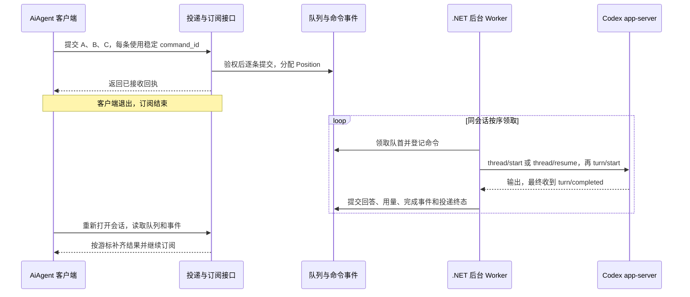

# Codex 已投递消息的后台顺序执行

## 当前实现（2026-11-26）

Web 聊天发送带 `delivery_intent` 的普通消息时，SSE 和 WebSocket 都把输入交给随 API 启动的 [ChatDeliveryWorker](../backed/Services/Chat/Orchestration/ChatDeliveryWorker.cs)。浏览器订阅即时输出。任务的生命周期由宿主和显式停止控制。Worker 调用与原传输共用的 [ChatTurnExecutor](../backed/Services/Chat/Orchestration/ChatTurnExecutor.cs)，现有投递表分配顺序，命令日志保存展示事件，模型调用、历史与用量各走原有路径。在线首个订阅使用有界事件通道；恢复订阅按数据库事件 ID 顺序读取，写入后唤醒等待读者。

重新登录后，侧栏通过 `GET /api/v1/chat/active-sessions` 获取本人的运行中会话 ID。打开会话会读取活动投递，凭原命令编号以 `recover_only` 订阅，可以补齐先前输出并接收后续增量。点击停止沿用原命令取消接口，收到 `cancelled` 后结束展示。若完成先于停止，显示已落库的回答。已确认排队的后续消息可以在浏览器关闭后继续；当前轮失败或被停止则挂起。

适用范围为单 API 实例、服务端执行的普通 Web 聊天投递，包括 Codex 与 LLM 路径。目标模式沿用原生暂停／继续。运行过程中需要保持 API、执行宿主和数据库可用。后端重启后，旧执行结果待核对，旧队列挂起。此版复用现有 SSE/WS 提交入口；下文单独的 202 接口、跨进程自动接管、结算事务和性能指标属于后续设计。

## 编排模块的职责

| 执行环节 | 代码入口 | 负责的决定 |
| --- | --- | --- |
| 传输与分派 | [ChatDispatcher](../backed/Services/Chat/Orchestration/ChatDispatcher.cs) | 两个流式入口认证后提交同一请求。分派器恢复投递参数、校验会话，再决定交给后台、在连接内执行或订阅已有命令。 |
| 后台执行与队列 | [ChatDeliveryWorker](../backed/Services/Chat/Orchestration/ChatDeliveryWorker.cs) · [ChatDeliveryService](../backed/Services/Chat/Orchestration/ChatDeliveryService.cs) | Worker 管理执行令牌和首个订阅通道。投递服务负责会话内排序、追加、权限复核与停止。 |
| 单轮准备与执行 | [ChatTurnPreparation](../backed/Services/Chat/Orchestration/ChatTurnPreparation.cs) · [ChatTurnExecutor](../backed/Services/Chat/Orchestration/ChatTurnExecutor.cs) | 执行器取得执行权后解析输入与上下文、写用户消息，再发送 `session_ready`。重复命令在准备阶段之前转为回放。 |
| 模型与即时输出 | [ChatOrchestrator](../backed/Services/Chat/Orchestration/ChatOrchestrator.cs) · [ChatProviderOutput](../backed/Services/Chat/Orchestration/ChatProviderOutput.cs) | 前者选择 Codex 或其他模型执行路径。后者逐事件转交正文、思考、工具和来源，同时收集保存回答所需的字段。 |
| 结果保存与回放 | [ChatRunFinalizer](../backed/Services/Chat/Orchestration/ChatRunFinalizer.cs) · [ChatCommandStore](../backed/Services/Chat/Orchestration/ChatCommandStore.cs) | 收尾依次保存回答和用量，再由执行器发布完成事件。命令存储负责去重、记录可回放事件及唤醒订阅者。 |

API 宿主调用 [AddChatOrchestration](../backed/Services/Chat/Orchestration/ChatOrchestrationModule.cs) 注册模块。后台宿主和分派器使用同一个 Worker 实例。

## 原设计目标

在 AiAgent 普通 Codex 聊天里依次发送 A、B、C。只要服务端已确认接收，关闭浏览器、退出连接 AiAgent 的客户端或断网后，A 继续运行，A 的结果保存成功后启动 B，接着执行 C。重新打开同一会话时，能看到已完成的回答、正在运行的轮次和排队位置。

「已接收」以数据库事务提交为准。只有草稿、仍在上传的附件或尚未获服务端确认的发送，界面显示为待确认，可用原命令编号查询。后台服务与工作区所在机器需保持可用。额度耗尽、超时、权限撤回和用户主动停止沿用失败或挂起规则。

本文以 AiAgent 的 .NET 后端所启动的 `codex app-server` 普通聊天为首期范围。「按顺序」定义为同一用户、同一会话内按服务端受理顺序执行，不同会话受现有用户并发上限约束。KunBuddy 自带的本地 Agent 有独立的 Electron 和运行时生命周期，需在其运行宿主单独实现。 [KunBuddy 退出流程](../client/apps/desktop/electron/main/bootstrap/shutdown.ts)

## 改造前的执行链路

| 源码 | 当前行为 |
| --- | --- |
| [ChatDeliveryService.cs](../backed/Services/Chat/Orchestration/ChatDeliveryService.cs) | `ai_chat_delivery` 已保存请求、指纹、`Position` 和 `Held`。`StartNext` 取最早的排队项，但要求该项仍在内存 `Attached`，然后唤醒等待中的请求。进程变化后，旧的运行条目标记为 `uncertain`，旧排队项挂起。 |
| [ChatAppService.cs](../backed/Services/Chat/ChatAppService.cs) · [ChatWebSocketHandler.cs](../backed/Services/Chat/ChatWebSocketHandler.cs) | SSE 和 WebSocket 在连接处理器里执行附件解析、编排、流输出及结果保存。WebSocket 关闭会取消相连的执行令牌，SSE 也把请求令牌传给执行链路。 |
| [ChatCommandStore.cs](../backed/Services/Chat/Orchestration/ChatCommandStore.cs) | 现有命令去重和事件回放可复用。命令在排到执行时才登记，因此查询还没开跑的任务需要先看投递记录。当前发送端以回答和用量写入后的 `completed` 作为结束确认。 |
| [CodexChatService.cs](../backed/Services/Chat/Codex/CodexChatService.cs) | Codex app-server 是后端启动的 stdio 子进程。预热和回收以 `ClientRuntimeId` 及浏览器心跳为基础，回收器会跳过忙池。原生 thread ID 已能按配置绑定保存，现有 `clientUserMessageId` 用的是会话 ID。 |

因此只把 `RequestAborted` 换成 `CancellationToken.None` 无法解决问题。排队项仍需要连接来领取执行，流写入失败也仍可能影响任务。已有约定见 [聊天消息排队与原生追加](chat-message-delivery.md) 和 [聊天命令去重与输出恢复](chat-command-recovery.md)。

## T3 Code 的实现参考

以下基于本地 T3 Code 快照 `0bb6eaa546c91915efbd3f092088c694f3949709`。

| 机制 | 源码行为与 AiAgent 可复用的设计 |
| --- | --- |
| 服务端接收和执行 | `message.dispatch` 交给编排器，事件、命令回执及待执行 effect 经提交路径写入存储。独立 `EffectWorker` 从 `EffectOutbox` 领取，客户端断开后服务端仍可继续消费。AiAgent 已有可持久化领取的投递表，第一版可直接把它作为任务来源。 [Orchestrator](https://github.com/pingdotgg/t3code/blob/0bb6eaa546c91915efbd3f092088c694f3949709/apps/server/src/orchestration-v2/Orchestrator.ts#L14975) · [EventSink](https://github.com/pingdotgg/t3code/blob/0bb6eaa546c91915efbd3f092088c694f3949709/apps/server/src/orchestration-v2/EventSink.ts#L736) · [EffectWorker](https://github.com/pingdotgg/t3code/blob/0bb6eaa546c91915efbd3f092088c694f3949709/apps/server/src/orchestration-v2/EffectWorker.ts#L801) |
| 排队与恢复 | T3 Code 用 `queuePosition`、`queueHeld` 和运行状态参与调度，线程订阅按 `afterSequence` 补事件。服务重启另有协调逻辑，其中会把普通待投递输入留在挂起队列。AiAgent 可保留当前「失败后挂起」，用命令事件游标恢复展示。 [QueuedRunOrder](https://github.com/pingdotgg/t3code/blob/0bb6eaa546c91915efbd3f092088c694f3949709/apps/server/src/orchestration-v2/QueuedRunOrder.ts#L12) · [WebSocket 订阅](https://github.com/pingdotgg/t3code/blob/0bb6eaa546c91915efbd3f092088c694f3949709/apps/server/src/ws.ts#L892) · [重启协调](https://github.com/pingdotgg/t3code/blob/0bb6eaa546c91915efbd3f092088c694f3949709/apps/server/src/orchestration-v2/ProviderRuntimeRecoveryService.ts#L378) |
| 进程生命周期 | T3 Code 桌面自管的后端实例在所属生命周期结束时会停止。独立的 `t3 service install` 提供另一种宿主，Windows 使用当前用户的计划任务启动无界面服务，macOS 和 Linux 分别有 launchd、systemd 用户服务。AiAgent Web 版可直接复用已独立部署的 API 进程。 [桌面生命周期](https://github.com/pingdotgg/t3code/blob/0bb6eaa546c91915efbd3f092088c694f3949709/apps/desktop/src/app/DesktopLifecycle.ts#L283) · [桌面后端回收](https://github.com/pingdotgg/t3code/blob/0bb6eaa546c91915efbd3f092088c694f3949709/apps/desktop/src/backend/DesktopBackendManager.ts#L1185) · [后台服务](https://github.com/pingdotgg/t3code/blob/0bb6eaa546c91915efbd3f092088c694f3949709/apps/server/src/cloud/bootService.ts#L203) |

## 推荐实现

### 1. 投递、订阅和停止各自有独立生命周期

- **投递。** 提议新增 `POST /api/v1/chat/sessions/{sessionId}/deliveries`。沿用 `ChatCompleteRequest` 的用户输入字段，普通 Codex app-server 首条和后续 `queue` 消息都走同一个入口。首次提交原子创建本人会话记录（如仍待创建）和投递行，提交后返回 `202` 及 `session_id`、`command_id`、`position`、`status`、`queue_held`。相同编号和指纹返回原回执，换正文、附件或执行配置返回 `409`。同一输入框依次提交，确认上一条受理后即可发送下一条。客户端超时先查询原编号，缺记录时仍用原编号提交。
- **查看。** 复用会话队列列表及命令事件存储，提供按命令查询状态和按事件游标的只读 SSE。首次打开用服务端快照和游标对齐已保存历史，再拉增量。同编号、同事件 ID 去重。任务尚未领取时也能查到 `queued`；有多个活动／排队编号时从服务端恢复，浏览器存储仅用于暂存未确认编号。关闭 SSE 或刷新只取消订阅。
- **停止和恢复。** 复用现有取消入口。待执行项可取消，活动项由 Worker 按命令取消；只有收到终态或确认进程已停止才能显示已停止。失败或主动停止时挂起后续待执行项。恢复操作从最早的挂起项继续，检查完不确定结果后显式放行，避免中间项越过队首。

### 2. 把执行迁到 .NET 后台服务

Worker 是首期必做项。它随 AiAgent API 宿主启动，负责在没有订阅者时领取队列、执行和结算。首期复用现有独立部署的 API 进程，在进程内注册 `BackgroundService`，避免额外部署一个服务。

- 在 `backed/Services/Chat` 增加 `BackgroundService`，按 `UserId + SessionId` 调度，队首从数据库读取，唤醒信号只用于减少延迟。启动和周期扫描补捞已提交但未唤醒的数据。复用 `AiChatDelivery` 主键、队列上限和请求指纹，增加向后兼容的执行方式字段及必要的执行阶段／原生轮次字段。旧数据按原方式处理，既有挂起项由用户明确恢复。
- 单 API 实例先落地。用现有会话锁配合短事务分配 `Position` 并条件领取，领取与命令登记一起提交。内存任务对象仅用于运行期控制；保存记录、比较位置及更新终态以数据库为准。一个会话的后台运行与旧流式执行、目标模式共用运行排他判断，避免两条入口同时改同一会话。跨会话沿用 Codex 用户并发预算，额度暂满时保留排队。
- 从 SSE／WebSocket 抽出可在新 DI scope 中重用的轮次执行逻辑，包括附件、项目引用、显式技能、Prompt 上下文、编排、历史和用量。Worker 用投递行的用户 ID 重新加载当前用户和项目权限、检查会话与附件并解析模型，按服务端保存的配置继续。请求快照保存原文、资源标识和选择项。运行时重新解析的路径、网页登录 Token 和进程句柄不写入快照。失效的输入明确失败并挂起后续项。
- Worker 的取消源来自宿主停机、任务超时和显式停止。使用服务端拥有的 Codex 运行标识及租约，忙时持有，空闲后回收，网页心跳继续负责当前的预热通道。保持已有工作区、图片与权限模式校验。普通队列以原生 thread 绑定延续上下文，原生追加继续走 `turn/steer` 并校验活动轮次。
- 遇到 Codex 的 `turn/completed` 后按其状态结算。成功时，在同一短事务中提交回答、用量、命令完成事件及投递终态。现有保存方法需支持复用同一事务，或使用按 `command_id` 幂等的结算记录补齐部分写入。后续项只在成功提交后可领取。调试记录和 SSE 推送失败单独处理。

### 3. 重启时按已知执行证据处理

| 可验证的情况 | 处理 |
| --- | --- |
| 已提交回执、仍在排队，或领取后可证明尚未进入发送阶段 | 重新参加调度，前提是队首未挂起、前序终态明确。 |
| 准备发送 `turn/start` 前已写入发送标记，但服务在发送或接收确认时退出 | 标记 `uncertain`，暂挂本会话后续消息。禁止自动再发同一条。 |
| 已取得原生 turn ID | 用服务端保存的 thread ID、turn ID 核对 `thread/read` 历史。可将普通后台轮次的 `clientUserMessageId` 改为 `command_id`，帮助恢复没来得及记下 turn ID 的关联。历史中明确匹配且能恢复结算数据时只补存结果。缺证据时保留待确认。 |
| 已保存终态，但通知没送达或下一个任务还没唤醒 | 回放已提交事件，启动扫描继续领取符合条件的队首。 |

Codex 的 `clientUserMessageId` 是消息关联字段。原生 `thread/resume` 负责打开已保存会话，`turn/start` 会开始新的一轮。外部工具可能在崩溃前已经改过文件，故障恢复以已保存结果和工作区证据为准，重跑需由用户明确发起。 [Codex App Server 官方文档](https://learn.chatgpt.com/docs/app-server) · [本地协议快照](../../codex/codex-rs/app-server/README.md)

### 4. 部署与客户端提示

Web 版优先把 Worker 注册到已有独立部署的 AiAgent API。开发时关闭浏览器可验证功能，停止承载 API 的 `dotnet run` 或调试进程会进入重启恢复。Windows 正式部署可用独立服务账号运行后端，确保该账号能访问项目目录、数据库和 Codex 登录环境。如果后续把本地后台能力接入 KunBuddy，应由独立于 Electron 的宿主持有任务与 Codex 进程，再由桌面连接它。机器休眠、关机或本地工作区离线期间无法继续实际执行，需保持工作区所在机器可用。

在现有输入区队列显示「已排队」「执行中」「已完成」「已挂起」「结果待确认」。服务端给出接收回执后可以提示「关闭窗口后仍会执行」。首期目标模式、exec Profile 及其他 Provider 继续走现有协议。普通后台执行使用该任务已校验的权限策略，遇到需要交互处理的情况按现有能力失败或进入可见的等待状态。

### 5. 保持现有聊天体验

| 用户操作 | 实现要求 |
| --- | --- |
| 发送首条消息或连续追加 | 点击发送后立即显示本地消息，提交中显示「发送中」，拿到回执或首个已持久化事件后确认接收。同一输入框仍可继续输入，按顺序提交已经点击发送的消息。网络超时保留内容及原命令编号，重连后核对状态。空闲会话收到首条后直接唤醒 Worker。 |
| 观看流式输出 | 沿用现有会话页面、输入框、滚动行为、流式文字、工具状态、附件和引用展示。已有会话可复用当前订阅，新会话拿到回执后立即订阅并按游标补齐此前输出。Worker 写事件后唤醒订阅，慢连接按自己的游标分页追赶。恢复时合并历史和增量，避免已显示的文字重头播放或重复触发依赖 `completed` 的操作。 |
| 使用「排队继续」「追加当前任务」「自动选择」 | 保留三种选择及默认的「排队继续」。普通队列按序进下一轮，原生追加直接交给同一活动轮次的控制通道，等待其 RPC 回执。自动选择沿用既有能力和上下文匹配规则。 |
| 停止、取消或切换会话 | 沿用现有按钮和授权范围。停止当前任务时即时反馈「正在停止」，终态确认后更新消息并挂起后续队列。取消排队项保留现有行为。切换会话只变更订阅对象，回到原会话可继续看到实时进度。 |

启用前先记录旧路径基线，按部署配置逐步开放给兼容客户端。后端在 Worker 可用时接收新的后台投递，客户端以受理回执确认任务已进入后台队列。灰度回退时关闭新后台入口，已确认的后台命令继续由原 Worker 结算或保留可恢复状态。客户端在回执不明时用原编号查询，禁止自动改走旧接口重发。

### 6. Worker 调度和时效目标

- **提交后立即唤醒。** 入队成功、前一轮终态提交、并发名额释放、显式恢复和取消队首时，通知 Worker 重新判断哪些会话可以执行。启动时先检查活动状态，再扫描可执行队首。运行中以约 2 秒的可配置扫描周期补捞丢失通知，复用队列索引控制查询范围。T3 Code 的 Worker 同样用通知及时唤醒，用轮询处理遗漏的唤醒。 [T3 Code EffectWorker](https://github.com/pingdotgg/t3code/blob/0bb6eaa546c91915efbd3f092088c694f3949709/apps/server/src/orchestration-v2/EffectWorker.ts#L967)
- **首轮复用预热。** 预热与实际执行使用同一受控租约管理。已热且用户、工作区、模型和权限绑定匹配时，Worker 可以租用闲置 app-server，执行期间持有租约。浏览器心跳只管理预热和空闲回收。避免同一用户因同时保留浏览器预热池和后台运行池而额外占用并发名额。空闲连接没有可用的热进程时按原有方式冷启动。
- **限制并发和等待。** 同会话最多一轮，跨会话按已有并发预算领取。遇到用户并发已满、挂起或需要核对的会话，调度器继续检查其他可执行会话。排队等待单独计时，不消耗 Codex 的执行和无事件超时。不同阶段分别记录时间，便于定位数据库、Worker、附件预处理、冷启动或模型响应造成的等待。

以下为首轮建议验收目标，尚未实测。使用同一 API、数据库和合成 Codex，在工作区可用、并发容量充足且附件已上传的条件下，对旧路径和新路径分别采样。

| 测量项 | 建议目标 |
| --- | --- |
| API 收到投递到返回持久化回执 | P95 ≤ 300 ms。附件上传耗时单独记录。 |
| 投递已可执行到 Worker 领取，含首条与后续轮 | 正常唤醒时 P95 ≤ 200 ms。后续轮提前排队时，从上一轮终态提交开始计时。人为丢弃一次唤醒后，在健康负载下 3 秒内补捞。 |
| 用户在线时的首段真实输出 | 同环境的预热路径对比旧版，从发送到显示的 P95 增量 ≤ 200 ms。另报冷启动和真实模型耗时。 |
| 流中实时更新与显式停止 | 从展示事件提交到浏览器显示的 P95 ≤ 200 ms。停止请求受理 P95 ≤ 300 ms，Codex 实际终止耗时单独记录。 |

## 实施步骤与验收

1. 增加投递／查询 API、兼容数据库迁移及 Worker，打通命令领取、Codex 上下文和结算。用 [ChatDeliveryTests](../backed.tests/ChatDeliveryTests.cs) 与 [ChatCommandTests](../backed.tests/ChatCommandTests.cs) 覆盖并发编号去重、启动补捞、位置顺序、结算事务和权限撤回。在实际部署使用的 SQL Server 上校验事务和索引行为。
2. 接通前端现有普通 Codex 聊天的首条发送、队列、重连和停止。用 [ChatDeliveryTransportTests](../backed.tests/ChatDeliveryTransportTests.cs) 及 [浏览器测试](../front/tests/chat-delivery.browser.mjs) 扩展覆盖，用合成 Codex app-server 在 A 运行期间提交 B、C，等到回执后关闭所有客户端。断开时间跨过原有心跳有效期，服务端应按 A、B、C 顺序各启动一次，新页面恢复三条结果，无重复用户消息或用量。
3. 注入故障场景，分别在投递已提交但 ACK 丢失、运行已领取但尚未发送、Codex 已接受但后端尚未记 turn ID、结算成功但通知丢失时中断。验证原号重查、可安全补捞、歧义挂起和终态回放。另查取消 B 后 C 能顺序推进、停止 A 后 B/C 挂起、目标／旧入口不能并发越过后台队列。
4. 独立部署后用隔离工作区执行三条简单、顺序相关的真实 Codex 任务，再彻底退出客户端。复开后核对结果、文件修改、每轮用量和完成顺序。验收同时分别记录关闭客户端与终止后端时的表现。
5. 同配置对比改造前后的首条发送、首段流输出、后续轮接续和停止。补测活动轮次的原生追加、显式技能、图片与引用展示、并发占满、故意丢弃唤醒、慢订阅者，以及有积压时其他会话能否正常发起对话。时效按上述分段目标验收，隔离模型与冷启动波动。

当前已落地的范围与剩余设计见文首。
