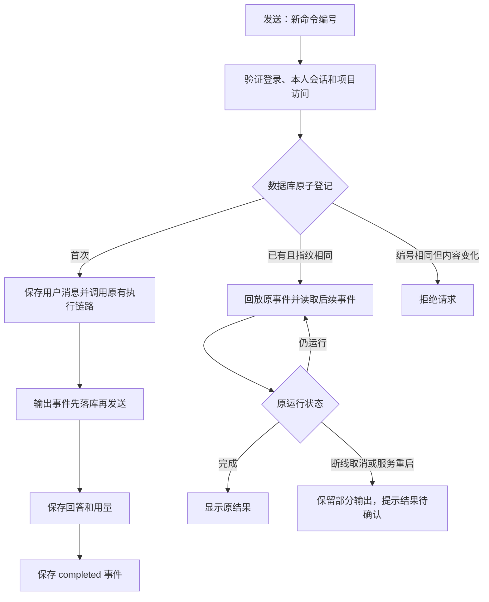

# 聊天命令去重与输出恢复

普通聊天发送时生成 `command_id`，同一轮网络重试沿用编号，主动再次发送生成新编号。HTTP SSE 和 WebSocket 共用 `ChatCommandStore`，在解析附件、写入用户消息和调用模型之前登记命令。数据库主键保证并发请求只有一个执行者，重复请求回放原事件，不重复写历史、记用量或调用模型。

## 数据与接口

- `ai_chat_command`：用户 ID 与命令 ID 的 SHA-256 作为主键，记录会话、请求指纹、服务进程编号、状态及项目权限引用。
- `ai_chat_command_event`：保存完整的展示事件；自增 ID 作为内部游标，`CommandId + Id` 索引支持分页读取。每次恢复从空的前端流记录回放，之后按游标读取增量，避免对已有正文重复追加。
- 请求新增可选 `command_id` 和 `recover_only`。后者只允许找回已有命令；不存在时拒绝执行。旧客户端未传编号时继续使用原协议。非流式 `/complete` 不接受命令编号，防止默默绕过去重。
- `POST /api/v1/chat/commands/{commandId}/cancel?session_id=…`：验证本人会话与当前项目权限，取消当前进程里的原执行。返回 `{ accepted: boolean }`。浏览器停止操作同时关闭自己的流。

编号不能换消息、模型、权限、技能或附件；仅运行标签和调试追踪不参与指纹。恢复依据服务端保存的项目引用复核权限，不能通过修改恢复请求的项目绕过检查。

## 使用边界

本实现把命令登记放在传输入口，而不是只改 Native 的 `RunCoordinator`。这样普通 Codex、DeepSeek Harness、旧 AgentLoop 与 Native 都使用同一个去重边界，已有 Native 运行表继续负责运行统计。没有给每条 Native 运行复制回答快照；完整输出由命令事件日志负责，避免依赖原来只保存脱敏元数据的运行事件表。

浏览器仅在当前标签页 `sessionStorage` 保存最近 24 小时、最多十条待确认命令的编号、会话及项目标签，不保存提示词和附件。刷新后发出只恢复请求；成功后清除指针，中断的部分输出可继续恢复，同会话新操作替换旧指针。禁用存储时仍可正常发送，但刷新恢复不可用。

保留原有断线取消语义，没有把模型执行变成脱离连接的后台任务。刷新可能取消原执行；恢复已有输出不等于继续执行。服务重启后遇到旧进程的活动命令，只展示已保存事件并提示结果待确认，不自动重新调用模型或工具。目标模式保持独立的原生暂停／继续协议，不加入通用命令重试。

服务端明确报错后停止自动重试该命令；纯网络失败仍可在 20 秒后凭原编号查询。`done` 只表示模型已给出回答，新协议必须等历史保存后的 `completed` 才确认成功，防止历史尚未保存就误判交付完成。需要重新执行时由用户发起新操作。

当前面向单 API 实例，不承诺跨实例接管或工具级 exactly-once。新增两张表通过原有 CodeFirst 启动阶段创建，无需修改旧表。每个展示事件先持久化再发送，会增加数据库写入；没有测量生产延迟。事件按聊天内容保护，不应将其视为脱敏运维日志。

## 验证

`backed.tests/ChatCommandTests.cs` 使用临时 SQLite 和模型替身验证并发唯一执行、输出回放、活动订阅、取消、进程重启、编号冲突、身份隔离及 SSE 入口不重复历史和用量。相关 AgentRuntime、目标、技能与启动结构测试一并回归。

前端测试覆盖稳定编号、20 秒查询、停止、目标隔离、刷新只恢复、存储故障和必须等待 `completed`。另执行 TypeScript 检查。未连接生产数据库，未调用真实模型；生产数据库性能与真实浏览器网络切换仍需部署后观察。
