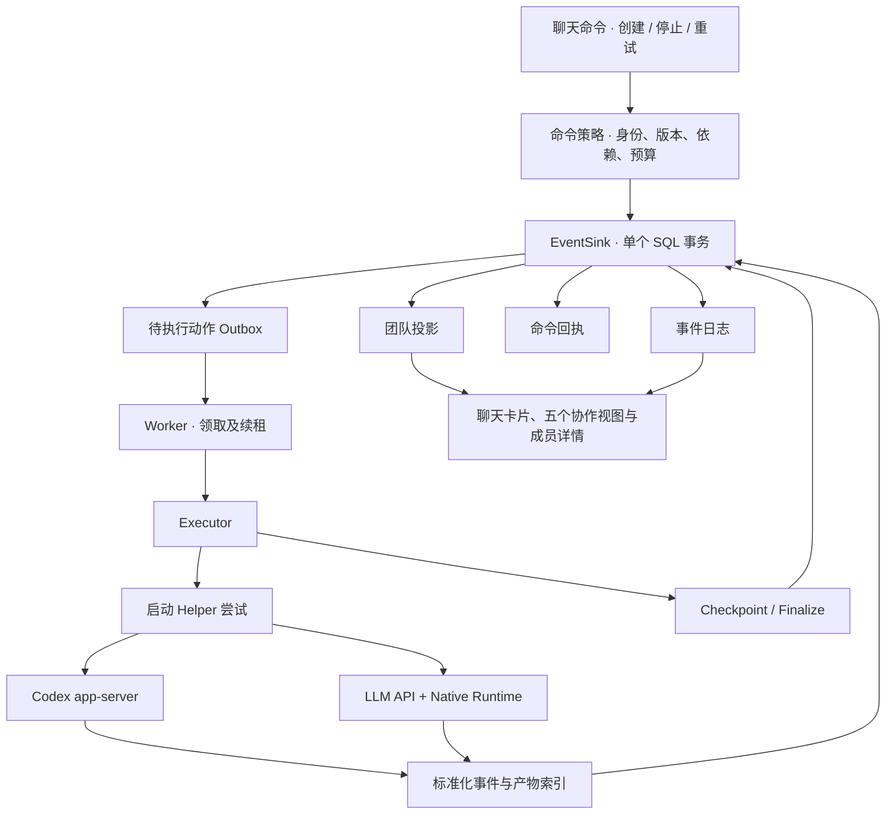

# 从一次聊天到一支 Agent 团队

**可以做。建议把团队运行挂在一条聊天提问上，由后端负责调度，由 Lead 对用户交付一个答案。** 普通问题继续直接回答。需要勘察、实施和独立复核时，用户在输入区选「Agent 团队」，发送后原位置出现任务卡，点开才看到集群、成员和证据。这样一次失败可以定位到一个步骤，用户也能继续在熟悉的会话里追问。

本方案针对当前工作区的 AiAgent Web 端（Next.js + .NET + SQL Server）。把图一的「集群」解释为同一任务下按职责分组的 Helper；物理主机、进程池和模型供应商另行分配。图二提供执行一致性的参考。本文描述的团队协议是设计提案，HTML 使用本地模拟数据。[打开交互原型](../design/chat-team-orchestration.prototype.html)

## 先看现有聊天可以借用什么

| 当前代码中的边界 | 对本次设计的影响 |
| --- | --- |
| SSE 在请求内登记命令、保存用户消息、调用编排器、保存回答和用量，随后发送 `completed`。WebSocket 也有流入口。 | 两个传输入口共用一个团队命令处理器。开团队只登记一次，后台执行的取消令牌由 Worker 持有。浏览器关闭只结束团队订阅。 [ChatAppService](../backed/Services/Chat/ChatAppService.cs) · [ChatWebSocketHandler](../backed/Services/Chat/ChatWebSocketHandler.cs) |
| 投递表已保存队列；`StartNext` 仍要求队首请求在进程内的 `Attached`。另有命令去重和恢复读取。 | 借用现有投递语义。为团队步骤建立可由 Worker 独立领取的工作项，避免将六个 Helper 当作同一会话里六条普通排队消息。 [ChatDeliveryService](../backed/Services/Chat/Orchestration/ChatDeliveryService.cs) · [ChatCommandStore](../backed/Services/Chat/Orchestration/ChatCommandStore.cs) |
| 当前工作树的 `ChatOrchestrator` 按 agent 分流。Codex 默认实例委托给 CodexChatService，注册表按 kind 缓存默认实例。无外部 agent 时，依配置走旧 AgentLoop 或 RunCoordinator。 | 复用现有路由和服务端配置。Helper 是任务角色，与 Provider 实例、CLI 进程、模型名称分别建模。首版可以只配置一个 Codex 实例和一个 API 模型。 [ChatOrchestrator](../backed/Services/Chat/Orchestration/ChatOrchestrator.cs) · [Provider 注册表](../backed/Services/Chat/AgentProviderRegistry.cs) · [Codex 驱动](../backed/Services/Chat/CodexAgentProviderDriver.cs) |
| Native 路径已有按 run 递增的事件序号和数据库运行记录；活动取消源保存在进程内。Native 工具调用受部署开关及模型能力控制。 | 单个 Helper 的执行细节继续存原运行记录。团队层补跨步骤顺序、依赖、检查点和重启对账。须将子运行绑定到独立上下文，防止其他 Helper 读到同一 Native 历史。 [RunCoordinator](../backed/Services/AgentRuntime/RunCoordinator.cs) · [NativeAgentRuntime](../backed/Services/AgentRuntime/NativeAgentRuntime.cs) · [AgentRunStore](../backed/Services/AgentRuntime/AgentRunStore.cs) |
| 聊天已有输入菜单、右侧检查器、Git「协作」时间轴及 Codex 目标模式；仓库还保留了代码任务集群设计。 | 增加入口「Agent 团队」和右侧页签。保留「协作」的 Git 含义。沿用已有设计的候选版本交接；本次补齐的是从一条聊天创建团队、跨组领取和回写答案的闭环。 [KnowledgeChatHome](../front/components/chat/KnowledgeChatHome.tsx) · [已有集群设计](agent-cluster-product-prototype.md) · [目标模式契约](chat-goal-mode.md) |

## 图二怎样落到 AiAgent

以「修复订单筛选，验证翻页后仍保留状态」为例。用户提交一次；Lead 拆出六项可检查的工作；勘察结果和验收条件到齐后，实施者改代码，同时另一位 Helper 设计回归用例。验证组收到封存的候选版本和用例之后才开工。Lead 最终引用候选版本、验证结果和遗留问题。这里最值得从图二借用的是**数据库先记下决定，再让 Worker 做外部动作**。

| 图二中的职责 | 在本项目的最小落点 |
| --- | --- |
| ThreadManagement / Orchestrator / CommandPolicy | 从已授权的 session 和根消息取得项目范围，建立 teamRun。Lead 用结构化计划提出角色、输入、产出、依赖。策略层验证图无环、角色与工具可用、预算可承担，再产生命令决定。Lead 可用 LLM，领取与终态判断由确定性代码完成。 |
| EventSink / EventStore / ProjectionStore / CommandReceiptStore / EffectOutbox | 同一 SqlSugar 事务提交团队事件、当前状态、命令回执与后续动作。提交成功后通知订阅者。投影按团队顺序可重建。首期可用同一数据库的表和一个写服务。 |
| EffectWorker / EffectExecutor | .NET BackgroundService 限额领取 ready 动作，处理 start、interrupt、checkpoint、finalize。每次领取写 owner、leaseUntil、递增 fencingToken；领取和改态作单次条件更新。执行外部调用时释放数据库事务。 |
| ProviderSessionManager / TurnStart / RunExecution / ProviderEventIngestor | 解析本次尝试的身份和隔离上下文，选适配器，建立或验证原生会话绑定；把运行回调归入确定的 attempt。单个 Helper 可有多轮；一个 Provider 的工具循环由该运行时独占。 |
| RunFinalization | 在结束通知后验证产物存在且对应输入版本，记录实际用量，再释放后继步骤。所有必需步骤通过才触发 Lead 汇总；根消息落库后在聊天发送完成事件。 |

图二中「执行动作」和「保存事实」的边界可在同工作区 T3 Code 实现里核对。首版在一个 .NET 进程内按职责组织即可，数据库提供重启后的依据。[EventSink](../../t3code/apps/server/src/orchestration-v2/EventSink.ts) · [EffectWorker](../../t3code/apps/server/src/orchestration-v2/EffectWorker.ts)

## 两种执行器如何交接

建议让编排器依赖一个按尝试执行的窄接口。输入包括 attemptId、逻辑角色、scope、模型能力、只读输入引用、允许的工具、工作目录、预算和截止时间。输出包括带身份的事件流、终态、产物引用、实际用量（未知则明确标记）及可选恢复引用。start/observe/cancel 为核心操作；steer/resume 通过能力探测启用。服务端绑定保存实例、工作区及原生标识。

| | Codex CLI | LLM API |
| --- | --- | --- |
| 打开与执行 | 沿用现有 app-server JSON-RPC。为 Helper 打开 thread，持久化 threadId；启动 turn 并绑定 turnId。独立可写目录与单写租约绑定。 | Native Runtime 为 Helper 装配目标、有限上下文和工具清单，发流式请求，在允许的步数和调用上限内运行工具循环。纯文本模型可承担无工具的规划和摘要。 |
| 进行中 | item 增量供详情展示；匹配原生轮次且支持时可 steer。interrupt 后等到轮次终态并核对退出情况。 | 增量文本、工具提案、执行结果分别映射。本轮追加默认排到下一轮；取消 HTTP 流后，仍须核查已发出的工具调用。 |
| 完成与续接 | 检查 turn/completed 内的终态与产物；原实例、权限和工作区匹配且可恢复时才 resume。临时 thread 按不可恢复处置。 | 持久化上下文检查点、工具回执和产物引用。没有供应商续接能力时，从最后确认的检查点开新 attempt。 |
| 跨 Provider | 两端交换同一份交接包：目标版本、输入/候选版本、结构化摘要、证据 ID、未解问题。原生 threadId 只在所属实例内解释。 | 例如 API Helper 根据验收条件生成用例清单，Codex Helper 读取候选快照执行验证；模型声称「通过」须有对应退出码和报告才能满足关卡。 |

提取适配层时要注意：现有 Codex 默认实例会接收完整聊天请求。先在服务端建立 Helper 的 session、独立工作区及权限映射，核对内部历史与用量写入点，再复用底层执行；直接并行调用聊天 HTTP 入口会造成消息归属和计费混乱。当前 checkout 的协议可在本地核对。[Codex app-server 协议](../../codex/codex-rs/app-server/README.md) · [NativeTurnRunner](../backed/Services/AgentRuntime/NativeTurnRunner.cs)

## 数据所有权与故障决策

| 对象 | 标识与约束 |
| --- | --- |
| 团队运行 | teamRunId 关联 userId、projectId、sessionId、rootMessageId、目标版本。每个团队有一个 Lead；可在同一聊天里先后创建多支团队。每次读取、订阅、干预和产物下载均校验归属。 |
| 任务与尝试 | taskId 关联 groupId、角色、依赖、输入版本和验收项。每次执行产生独立 attemptId，只有当前尝试和持有效租约的 Worker 可推进状态。每个 Worker 上报可用 Provider 与容量。 |
| 命令与事件 | 命令按所有者、会话及 commandId 去重；相同负载返回原回执，不同负载返回冲突。事件唯一键为 (teamRunId, seq)，provider 回调按 attempt 和原生事件键去重；无稳定键时按接入时保存的来源游标或检查点对账。 |
| 产物与成果 | artifactId 指向经授权的快照、报告或文档，含来源 attempt、输入版本、摘要或哈希。候选改动固定在版本上。复核、批准、汇总均引用此版本；候选变更后使受影响的结论失效。 |

**执行中断的判定规则**

- **Worker 在调用前崩溃。** 已知未发出的动作到期后可重新领取。数据库领取、发送意图和外部调用之间存在窗口。已记发送意图却缺回执时标为「待核对」；查询原生 turn、工具回执或产物，有确定结果再继续。无法证实时由用户选择新尝试，尤其是写文件或其他有副作用的动作。
- **失败和迟到。** 已确认失败的步骤可以局部重试；只阻塞依赖它的后继。旧 Worker 回包写审计记录，凭 fencingToken、attemptId 和阶段版本拒绝旧结果覆盖。用户停止时先冻结派工、撤销队列，再发中断，活跃尝试全部确认后转已停止。
- **关页、重启、重复订阅。** 客户端先读快照及同一时点的 seq，再拉取 afterSeq；重复忽略、发现缺口补读，游标过期重取快照。断线不改变团队目标。后台重启执行租约和原生绑定对账。普通聊天和 Codex 原生目标模式仍走各自的恢复语义。
- **写入与花费。** 每个候选版本同一时刻只有一个写入者，测试在候选副本执行，审查拿只读证据。派工前预留并发与费用，按真实用量结算，未知费用保留待核对。按用户、项目、Provider 实例和主机共同限流；重试次数、工具次数、上下文大小和运行时间都有上限。
- **历史与最终回执。** 子运行输出写私有详情；根聊天仅追加一条团队答案。给最终消息和各 attempt 用量分别设唯一业务键。若聊天持久化与团队终态分事务，用幂等 finalize 动作补齐两边，再发布 completed，重放不重复收费。Lead 汇总失败只重试汇总。
- **上下文隔离。** 每个 Helper 获取根请求授权范围与角色需要范围的交集。交接只传可授权的材料引用和摘要；文件、网页、留言中的文字作为资料处理。用户追加改变目标时递增目标版本，重新判断受影响的运行和下游证据。

## 图一如何成为可用的界面

原型打开在一个进行中的团队。全局 Lead 上方保留会话和原始问题；下方按勘察、实施、验证分组，每个 Helper 均可选中查看使用的执行器、依赖、尝试次数、成果。五个协作区读同一个团队事件序列，分别回答五个问题。

| 图一区域 | 前端显示与后端含义 |
| --- | --- |
| Announce · 公告 | Lead 发布的当前目标、验收规则及变更版本。 |
| Assign · 分工 | 各集群的角色、负责人、模型能力和允许的操作。 |
| Notes · 留言板 | 人或 Helper 向团队提交的有来源留言。留言本身不触发改代码或扩大权限。 |
| Subtasks · 任务池 | 已创建的工作、前置依赖、执行中及失败尝试。Helper 在服务端通过受限领取接活。 |
| Landed · 成果 | 可供后续步骤消费的产物及证据版本。阶段成果可以先到达；Lead 的最终答复须等必需成果齐备。 |

图中 999 个 Helper 可以作为逻辑成员或可领取任务的规模目标。实际并行度取 ready 任务数、执行槽位、模型配额和预算中的最小值。示例采用 3 组、6 个角色、2 个并行槽。扩展时首页按组显示运行/等待/失败计数，只给展开组分页或虚拟化成员；事件流按团队订阅，详情按选中的 attempt 加载。这样才能看清「999 个成员中有 8 个活跃」的差别。跨主机部署还要解决工作区定位、凭据归属、共享产物与租约超时，不能仅靠扩大前端节点数判断容量。

建议新增的 HTTP 契约：在 `POST /sessions/{id}/teams` 携带 commandId、根输入和角色模板；返回 teamRunId、rootMessageId 和已提交版本。详情读 `GET /teams/{id}`（快照含 seq），续订 `GET /teams/{id}/events?afterSeq=n`。停止、定向留言及重试走 `POST /teams/{id}/commands`，包含目标 task/attempt、expectedVersion 和命令键。以上路径为提案，WebSocket 可复用同一命令处理器。用户在原聊天里普通追问仍按普通消息发送；向正在运行的团队发要求需明确选中目标。

## 分阶段上线与验收

1. **先打通后台最小闭环。** 功能开关仅开放一类任务模板和一个团队入口，用确定性假执行器验证事务、领取、订阅、局部重试与一次性回写。重复提交只生成一队；两名 Worker 争抢只一人获得有效租约；关闭所有浏览器后，后台仍可完成，重连能补齐事件。
2. **验证混合执行价值。** 单主机接 Codex 和一个已验证能力的 API 模型。先用 API 提取验收条件、Codex 准备候选，再用只读角色复核。关卡覆盖工具失败、无产物、取消、供应商限流、发送后断电和旧尝试迟到。复核报告与候选版本不一致时禁止汇总为成功。
3. **扩展团队与界面。** 开放多组并行、Lead 受约束拆解、五个协作视图、成员详情和定向指令。按同一批任务对比单 Agent 的验收通过率、端到端耗时、token/已验收任务、人工返工率；同时记录排队时间和有效并行度。比较结果决定是否增加 Helper 和执行主机。

灰度中可关闭新建团队入口，已有运行继续对账、停止或收尾。回归验收覆盖旧聊天的 SSE/WS、命令恢复、附件与知识范围、Git 协作及 Codex 目标续跑。HTML 可用于体验状态转换；后台恢复、真实模型质量、并发容量和成本需要在实施阶段实测。
