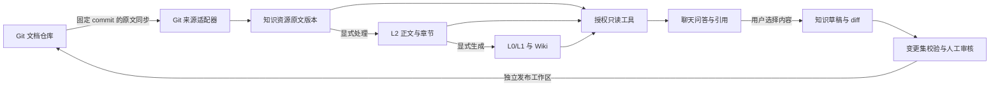

# 知识库关联 Git 与聊天知识沉淀方案

日期：2026-11-05  
状态：设计建议，尚未实现。依据当前仓库代码检查形成；本文不执行 Git 同步、提交或推送。

## 1. 结论与建议

可以做，而且当前工程已有较完整的基础。建议实现为 **Git 文档来源 + 知识资源投影 + 聊天知识变更集**：

- Git 管理团队确认过的文档原文及历史版本。
- 知识库负责文档解析、目录导航、摘要、Wiki 和 AI 查阅。
- 聊天负责选择知识范围、按需读取，以及将选中的新内容整理成可审核的文档变更。
- 发布由具备权限的人确认后完成，AI 可以建议归档位置和修改内容。

不建议把整个知识库存储目录直接变成 Git 工作目录。现有目录包含内部状态、个人产物和缓存，不能作为默认推送范围。

本文将“关联知识界”理解为“在聊天中关联知识库或知识目录，让 AI 自己定位相关内容”。如果指独立的知识图谱能力，应另做后续扩展；本方案不依赖知识图谱。

## 2. 当前代码已经具备什么

以下为实际代码中已存在的基础，不能等同于 Git 知识联动已经打通。

| 能力 | 当前代码位置 | 可复用部分与缺口 |
| --- | --- | --- |
| 知识库实体 | `backed/Entities/Knowledge/AiKnowledgeBase.cs` | 有 `MetadataJson`，但没有明确的 Git 绑定、同步版本及文件映射实体 |
| 知识资源目录 | `backed/Services/Knowledge/KnowledgeResourceService.cs` | 有资料、项目、人员 URI 根、原文与生成内容投影；目前不是 Git 来源适配器 |
| 知识目录只读工具 | `backed/Services/Knowledge/KnowAgent/KnowledgeAgentTools.cs` | 有 `ls/read/search/status`，每次执行校验所选子树；适合 AI 在授权目录自主查阅 |
| 普通知识检索 | `backed/Services/Chat/Retrieval/KnowledgeRetrievalService.cs` | 可按所选知识库走 Wiki 检索或活动 RAG 索引；与目录工具是不同入口 |
| 聊天选择知识库和项目 | `front/components/chat/KnowledgeChatHome.tsx` | 已有知识库多选及项目选择状态；尚需统一资源范围和 Git 来源元数据 |
| 聊天资料库 | `front/components/chat/ChatLibraryPanel.tsx` | 可浏览项目文档和本人上传；不是完整的知识资源目录选择器 |
| 仓库文档操作 | `backed/Services/CodeRepository/CodeRepositoryManager.cs` | 有项目文档列表、预览、上传、下载及引用解析，适合复用 UI 与授权入口 |
| Git 仓库及账号关联 | `backed/Entities/CodeRepository/AiCodeRepository.cs` | 有项目、工作目录、Git 账号关联；账号需要按请求身份解析 |
| Git 执行与交付检查 | `backed/Services/Git/GitWorkspaceService.cs` | 有独占执行、状态、diff、交付检查与快照指纹；通用提交入口会 `git add --all` |
| 变更集数据结构 | `backed/Entities/CodeRepository/AiCodeChangeSet.cs` | 有审核、校验、交付状态和仓库快照字段，可参考其流程，不能假定直接适配知识发布 |
| 项目导航上下文 | `backed/Services/Chat/ProjectAgentMarkdownIndexContextService.cs` | 已有经授权注入导航文档的方式；只提供方向，不替代正文证据 |

现有知识资源树对共享资料与个人目录的处理不同，不能因为 URI 放在 `projects` 下，就认为已经具备 Git 仓库的项目权限。Git 来源投影必须额外接入项目与仓库访问校验。

## 3. 产品上怎样使用

### 3.1 在知识库中关联仓库

知识目录增加“关联 Git 文档来源”：

1. 选择当前用户可访问的已登记仓库；也允许先走现有仓库登记流程接入文档专用仓库。
2. 选择分支及仓库相对目录，例如 `docs/knowledge/`。
3. 选择挂载到哪个知识目录，并设置为只读同步或允许发起发布。
4. 预览文件清单、忽略规则和可见范围，确认后首次同步。
5. 单独选择是否解析、是否生成摘要或 Wiki；默认同步不触发模型费用。

建议第一阶段一个挂载目录只绑定一个来源；同一仓库可以绑定多个互不重叠的目录。分支切换作为绑定配置变更处理，不在普通聊天过程中切换。

### 3.2 在聊天里关联知识

输入区保留“选择知识库”，增加“选择知识目录/文件”。选中后展示范围标签，例如：

```text
当前项目：业务平台
知识范围：业务平台 / 操作规范
来源版本：仓库文档 @ <commit>
```

用户可以直接问：“根据操作规范，说明新增供应商要注意什么。”AI 在所选范围内列目录、查摘要、搜索关键词、读取正文，最后给出具体引用。用户无需预先知道文件名。

范围只决定可查阅的上限，不把整个目录正文一次性塞入提示词。没有找到、扫描不完整、未解析或来源过期时，需要明确说明。

### 3.3 在聊天里沉淀和发布新内容

助手消息、选中的文字或本轮整理结果增加“沉淀到知识库”操作：

1. 选择内容，查看本次将发送的确切文本。
2. 选择目标知识目录，AI 推荐新增文档或更新现有文档。
3. 展示标题、目标路径、来源消息和完整 diff；允许编辑。
4. 保存个人草稿，或者生成待审核的知识变更集。
5. 审核人查看校验结果后发布到指定分支。
6. 推送成功后，按实际提交版本同步回知识库；解析和提炼按明确选项执行。

界面应区分“保存草稿”“待审核”“已推送”“已同步”“已解析”。保存到本地数据库不显示为已推送，推送成功也不显示为摘要已生成。

## 4. 推荐架构与数据归属



每种内容都要有清晰归属：

| 内容 | 主要保存位置 | 是否默认进入 Git |
| --- | --- | --- |
| 已确认的文档原文 | Git；知识库保存受控同步副本 | 是，仅绑定目录白名单文件 |
| 聊天新整理内容 | 个人草稿及待审核变更集 | 否，审核后才发布 |
| L2 正文、章节和解析 manifest | 现有解析存储 | 否 |
| 个人摘要、Wiki、会话、模型缓存 | 现有个人工作区 | 否 |
| 团队希望公开维护的知识页面 | 人工选取后导出为普通 Markdown 原文 | 可显式发布 |

生成产物不能直接原地修改。需要发布摘要或 Wiki 时，先转为一份可审核的 Markdown 草稿，保留来源及生成状态，再走普通发布链路。

## 5. Git 同步如何保证一致

### 5.1 从固定提交读取

同步先解析分支对应的 commit，再从该 commit 枚举和读取文档；整批任务不跟随移动中的 HEAD，不读取混有未提交修改的开发工作目录。

服务端建立文件映射：`binding_id + commit_sha + relative_path + blob_oid + content_sha256 → document_version`。Git 对象 ID 和平台内容 SHA-256 分别保存，不假定两者相同。

只导入经过验证的相对目录及文件类型；拒绝越界、链接逃逸、大小写路径冲突、无效文件名、超限文件和不支持的对象。子模块、LFS 指针不作为正文导入，首版明确提示不支持。

### 5.2 增量更新与原子发布

- 新增：创建来源文档及版本映射。
- 修改：保留旧版本，发布新原文，旧摘要和旧索引不得继续标成最新。
- 删除：从当前来源清单移除，失效后续检索，保留历史引用所需记录。
- 重命名：通过前后清单处理，Git rename 检测只作辅助；不单靠文件名维持身份。

整批文件先准备齐，再原子切换当前同步清单；失败时继续展示上一个完整版本。数据库和文件系统跨介质发布要有可恢复状态，不依赖长事务包住 Git 或模型调用。

首版手动同步即可。后续定时任务或 webhook 只负责触发去重同步，不自动执行知识提炼。同步任务与 `wiki_compile` 分开建模，保留各自状态和取消语义。

### 5.3 多用户可见性

访问有效范围是“用户可访问项目/仓库 ∩ 绑定允许目录 ∩ 本轮选择范围”。每次列目录、读正文、搜索、下载和读取历史引用都重新校验。

用户的 Git 账号可用于本次授权操作，不能因此把该账号能读到的整个私有仓库公开给其他平台用户。后台同步必须保存明确的授权主体和委托策略；账号失效、绑定停用或权限撤销后停止同步并限制读取。共享缓存以来源保存，但不能绕过调用者权限。

## 6. AI 怎样定位到具体内容

建议统一知识资源读取接口，让普通知识聊天也能使用现有 KnowAgent 的目录能力，而不是只增加一段“请查阅知识库”的提示词。

推荐查阅顺序：

1. 服务端提供授权范围、目录名称、可用摘要及来源版本。
2. AI 按问题选择目录并搜索，保留分页和扫描限制。
3. 读取命中文档或章节原文，必要时继续读取相邻段落。
4. 回答中引用实际读到的正文；摘要用于定位，不能冒充原文证据。

拟新增统一工具名可为 `knowledge_list/read/search/status`，底层复用并扩展 `KnowledgeAgentTools`。具体适配当前聊天各运行通道时，分别验证原生工具调用、普通 API 与 Codex 通道，不能假定现有聊天入口都自动拥有这组工具。没有工具能力的通道可由服务端检索后注入有限证据，并明确能力边界。

引用建议包含：绑定 ID、资源 URI、文档版本、commit、相对路径、正文哈希、章节与字符区间。Markdown 可额外标注原文行号；Office/PDF 以解析版本和正文位置为准，不把解析行号当作 Git 原文件行号。

历史引用点击时默认读取当时版本，并显示是否已有新版本；失去权限后不能借历史消息读取正文。个人草稿内容带“未发布”标记，团队生成知识带“模型生成/待核对”标记。

## 7. 聊天发布链路的关键设计

### 7.1 先产生提案，再执行发布

AI 的写入能力首版限定为“提出文档变更”，工具只返回结构化提案：目标绑定、相对路径、基线 commit、期望旧内容哈希、新正文、来源消息 ID 和建议标题。服务端验证后保存草稿，不给模型通用 Git 推送工具。

保存草稿只需本人草稿权限；发布需要目标知识写权限、项目访问权及相应 Git 交付权限。首版可沿用现有 `CanCommitCode` 交付门槛；未来若开放给非开发人员，新增知识发布权限，并审视其与远端账号权限的交集。

### 7.2 不直接调用整仓提交入口

已核对 `GitWorkspaceService.CommitAndPushAsync`：它执行 `git add --all`。直接复用可能把其他代码改动带入知识提交。

推荐从目标基线创建隔离发布工作区，只应用经过审核的文件集合，仅暂存明确路径。路径即使以连字符开头也应按字面量安全处理；进程参数使用 `ArgumentList`，不拼 shell。复用现有 Git 独占执行、凭据解析与脱敏输出能力，增加专用的受限发布方法。

发布前复核绑定配置、目标分支、基线 commit、每个文件旧哈希、完整新内容和审核快照指纹。任何变化都使原审核失效。远端前进或非快进拒绝时进入冲突状态，重新生成 diff 并审核；首版不自动覆盖或强推。

### 7.3 可重试且不会重复发布

建议状态为：`draft → validating → awaiting_review → approved → publishing → pushed → synced`，另设 `conflict/failed/cancelled`。解析状态独立记录。

使用请求幂等键和发布操作 ID。若提交已创建但推送响应丢失，先核对远端是否包含预期 commit，再决定是否重试；不再创建一份相同提交。若已推送但同步失败，界面保留“已推送，待同步”，只重试同步。

首版可直接发布到绑定指定分支并遵守远端保护规则；需要 PR/MR 时再加供应商适配。受保护分支拒绝应清晰报错，不能宣称通用 Git 能力已支持 PR/MR。

## 8. 建议的数据模型与服务拆分

以下名称均为拟新增设计，不是当前已有 API 或实体。

| 实体 | 主要字段 |
| --- | --- |
| `AiKnowledgeGitBinding` | RepositoryId、ProjectId、挂载 URI、分支、来源相对目录、同步/发布策略、授权主体、配置版本 |
| `AiKnowledgeGitSyncRun` | BindingId、目标 commit、前次版本、状态、当前清单、文件数量、错误与时间 |
| `AiKnowledgeGitFileVersion` | BindingId、SyncRunId、相对路径、blob OID、内容哈希、DocumentId、不可变原文版本、删除标记 |
| `AiKnowledgeContribution` | OwnerId、SessionId、选中 MessageIds、目标绑定、基线版本、文件清单、审核指纹、状态、交付 commit、同步结果 |

新增字段遵守项目的可空列约定；新增实体主键沿现有方式，其余持久化字段显式标注 `IsNullable = true`。绑定关系不只塞进 `MetadataJson`：需要可查询、可锁定、可审计的数据；现有 organization 元数据保持原意。

建议服务边界：

- `KnowledgeGitBindingService`：绑定配置、访问权和目录映射。
- `KnowledgeGitSyncService`：固定版本读取、增量清单及原文发布。
- `KnowledgeContributionService`：选中文本、草稿、diff、审核及状态。
- `KnowledgeGitPublishService`：隔离发布、指纹复核及 Git 幂等恢复。
- `KnowledgeScopeResolver`：统一聊天、目录、下载和引用的可见范围。

优先参考现有变更集的审批与指纹设计。若通用变更集依赖整仓工作区，应扩展受限快照抽象或使用知识专用变更集，不能只替换按钮文案。

拟定 HTTP 能力包括绑定 CRUD、同步与状态查询、贡献草稿与 diff、校验/审批/发布、版本化引用读取。具体路由在实施时与 Furion 约定对齐；同步更新 DTO、`front/lib/knowledge-*-api.ts` 与类型，组件不散落直接 fetch。

前端建议复用 `KnowledgeResourcePicker`、`ChatDocumentCard` 和知识工作区，在聊天增加 `ChatKnowledgeContributionDialog` 及范围选择状态。切换项目/会话时取消旧请求，历史慢响应不得插入新会话。

## 9. 建议实施顺序

| 阶段 | 交付范围 | 可验证的用户收益 |
| --- | --- | --- |
| 一：Git 来源与读取 | 绑定已登记仓库的文档目录、手动固定版本同步、来源授权、聊天目录范围与正文引用 | 先让 AI 正确读取仓库知识，知道具体依据来自哪里 |
| 二：聊天沉淀与发布 | 选择消息、Markdown 草稿、目标建议、diff、受限变更集、审核、隔离推送与同步 | 用户在聊天里把选中的新知识发布回仓库 |
| 三：协作增强 | 定时同步/webhook、PR/MR、冲突辅助、失效知识提示与批量整理 | 支持团队长期维护 |

最小版本建议只发布 Markdown，支持新增及明确替换现有文件；删除、批量移动、Office 反向编辑、自动合并和自动发布暂不纳入。PDF/Office 的只读导入按现有解析白名单和限额逐步开放。

完整满足本次设想需要完成前两阶段。第一阶段只是先闭合可靠读取链路，不代表聊天发布已交付。

## 10. 验收重点

使用临时仓库、本地合成远端、隔离数据库和模型替身验证，不连接用户真实仓库或使用真实凭据。

1. 单次同步过程中远端分支移动，读到的文件仍来自同一个固定 commit；失败不发布半批数据。
2. 新增、修改、删除和重命名正确影响资源与摘要有效性，旧 RAG 结果不会作为当前 Git 原文回答。
3. 私有仓库投影、下载、搜索、历史引用和后台任务均拦截跨用户越权；撤权后旧会话不能继续读取。
4. AI 能在所选子树定位并读取文件，不能越界；扫描有限时明确报告，引用必须对应实际读取内容。
5. 仓库原工作区存在无关改动时，发布只包含审核文件，原工作区不被提交或清理。
6. 内容、路径、分支或权限变化后，旧审核不能继续发布；冲突不覆盖远端。
7. 推送响应丢失、同步失败及重复点击可恢复，既不重复提交，也不把未同步显示为已完成。
8. 原文已同步但解析/模型失败时，原文仍可下载，显示真实阶段，重试不无意触发额外模型调用。
9. 项目/会话切换、取消和迟到响应不污染当前选择；发布前用户能审阅实际 diff。

## 11. 对当前工程的最终取舍

保留现有知识库和仓库模块，在两者之间增加明确的来源与贡献层。优先解决版本、权限、引用和受限发布，再扩展自动化。

用户侧最终形成一个自然闭环：**选知识范围 → AI 查阅具体文档并引用 → 选择新内容 → 查看修改 → 审核发布 → 知识库同步新版本**。

本次仅产出方案文档，没有改动业务代码，没有运行构建、模型调用或远端 Git 操作。
