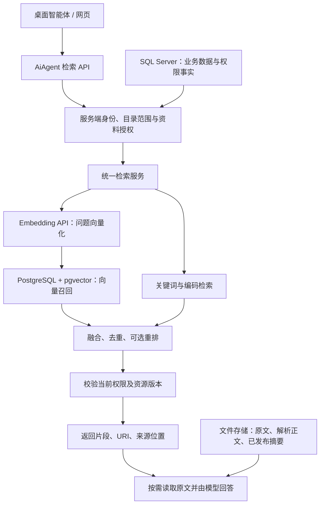

# AiAgent 接入 PostgreSQL + pgvector 的评估与实施建议

> 2026-10-15；基于本地 AiAgent 提交 `df3e002` 的静态代码核对。本文是方案评估，尚未实施数据库或业务代码改造，也未进行容量压测。

**建议引入 PostgreSQL + pgvector，定位为独立的知识检索数据库。保留 SQL Server 管理业务数据，保留现有文件存储管理原文，由 AiAgent 后端统一提供检索 API。**

这样能补齐目录式知识空间的向量语义召回，同时控制对现有系统的影响。真正需要处理的是检索入口、授权、版本和数据同步，而不是数据库之间存在天然不兼容。

## 1. 先明确要实现的能力

这里将“嵌入式向量化 API”理解为：调用 Embedding API，把文档和问题转成向量，再通过 API 提供语义检索。向量搜索本身就是语义搜索的一种实现；你需要组合的实际是：

- **向量召回**：找意思相近但措辞不同的内容。
- **关键词召回**：准确查找图号、物料编码、合同编号、产品型号和明确术语。
- **语义摘要导航**：通过 L0/L1 判断目录主题和资料范围。
- **模型阅读回答**：读取命中的原文证据，生成带引用的答案。

例如，“付款怎么约定的”可以通过向量找到“结算条款”；“零件 AB-120”则应保留精确型号匹配，避免相似型号被混淆。

如果“嵌入式”指安装在每台电脑中的离线数据库，则不建议第一阶段让每个客户端都部署 PostgreSQL。结合目前客户端与后台分工，优先把 PG 放在服务器，客户端调用后台搜索 API；本地未上传资料仍由客户端处理。向量并不能替代后台尚未获得的本地原文。

## 2. 当前代码已经有什么

| 范围 | 已核对的实现 | 接入 PG 的含义 |
| --- | --- | --- |
| 主数据库 | `backed/Program.cs` 配置 `DbType.SqlServer` | 新增独立连接，不替换全局 SqlSugar 数据库类型 |
| 目录式问答 | `KnowledgeResourceService.AskAsync` 按词项匹配候选，最多扫描 60 个候选、选取 12 个片段 | 可替换候选召回环节，继续复用读取与引用流程 |
| 目录 Agent 工具 | `KnowAgent/KnowledgeAgentTools.cs` 的 `search` 分批扫描 40 个文件，做名称/正文子串匹配 | 新增向量/混合搜索能力需要显式接入这里 |
| 传统 Wiki 检索 | `KnowledgeWikiRetrievalService` 调用模型和 `KnowledgeWikiSearch` 检索知识表示层 | 当前不是 embedding 检索，应作为独立策略保留 |
| 原文搜索 | `KnowledgeSourceSearchService` 读取原文或解析副本，进行子串匹配 | 保留精确搜索及未建索引时的有限检索能力 |
| 传统 RAG | `LlamaIndexPipeline` 调 Python worker；请求使用 `PersistDir` | 现有协议依赖文件目录，不是数据库 collection 协议 |
| RAG 工厂 | `RagPipelineFactory` 当前只实际支持 LlamaIndex | 填写 `pgvector` 配置不会自动获得新引擎 |
| 语义摘要存储 | `KnowledgeSemanticStore` 以指纹、不可变版本和原子 manifest 发布摘要 | PG 应索引已发布版本，不能绕过指纹校验 |

传统搜索 API 与聊天工具都优先检查 Wiki 模式。传统 API 在非 Wiki 模式且无活动索引时可以回退原文搜索，而聊天检索服务此时返回无活动索引。**当前各入口行为并不完全一致，接入时需要明确统一策略。**

因此，只把传统 LlamaIndex 换成 PG，目录式知识聊天不会自动获得向量搜索。

## 3. 建议的总体结构

| 数据 | 推荐位置 | 原因 |
| --- | --- | --- |
| 用户、项目、业务权限、现有任务 | SQL Server | 避免无关业务迁移 |
| PDF、Office、图片、音视频原始字节 | 现有受控文件存储 | 复用上传、下载、预览和解析能力 |
| 完整解析正文及已发布 L0/L1 | 现有存储，保持当前事实源 | 避免同时引入两套正文版本管理 |
| 分块文本、向量、检索元数据 | PostgreSQL | 支持一次查询返回可追溯的候选片段 |
| 摘要的检索副本 | PostgreSQL，可选 | 必须记录来源版本及指纹 |

**相关文档的向量数据可以集中存入 PG；原始文件无需一并迁入数据库。** PG 中的文本与摘要是可以重建的检索副本。

pgvector 支持向量距离检索和近似索引，并可与 PostgreSQL 全文检索组合。是否启用近似索引以及参数如何配置，应以实际数据量、过滤条件和召回率测试决定。[pgvector 官方文档](https://github.com/pgvector/pgvector)

## 4. 哪些地方会与现有代码冲突

| 冲突或风险 | 直接替换的后果 | 推荐处理 |
| --- | --- | --- |
| 全局数据库连接 | 用户、聊天、任务等全部进入数据库迁移范围 | PG 使用独立连接池和检索仓储 |
| Wiki 优先路由 | 已建 PG 索引仍然不被调用 | 增加明确检索策略，保留旧模式默认行为，按范围灰度 |
| 新旧知识入口分离 | 传统 API 有向量能力，目录 Agent 仍扫描字符串 | 让 API、目录问答与 Agent 工具复用统一检索服务 |
| `PersistDir` / `StoragePath` 契约 | 将 collection ID 当路径，会破坏路径检查和索引管理 | 新增索引定位抽象，区分文件目录和 PG collection，不借字段塞连接串 |
| `ActiveVersionId` | 半成品索引被查询，或历史索引无法回退 | 传统 RAG 保持活动版本语义；目录资源使用独立索引版本映射 |
| `wiki_compile` 任务 | 解析成功、摘要成功和向量成功混成一个状态 | 向量构建采用独立任务与状态，失败可单独重试 |
| 个人产物与共享资源 | 相同文件 URI 对应不同用户摘要，容易串数据 | 索引身份包含资源身份、可见范围、所有者与版本 |
| 双库和文件同步 | 原文更新/删除后，PG 仍返回旧片段 | 发布事件、幂等更新、删除标记、周期对账和读时复核 |
| 引用结构 | 只有 URI 或相似度，原有预览无法定位证据 | 保留文档 ID、URI、版本、页码/偏移等引用信息 |
| 模型配置变化 | 相同维度但不同模型的向量被混用 | 固定 embedding 模型及配置版本，更换时新建索引 |

最重要的权限原则：**URI 前缀、公司分类、知识库名称都不能独立充当授权证明。** 应从当前服务端身份和既有权限规则计算允许范围，在向量与关键词查询中都施加过滤。候选进入重排模型、回答模型或响应之前，再检查当前权限和版本；撤权或删除后不能因为索引尚未清理而继续泄露摘要。

目录 L0/L1 本身也可能泄露子文件信息。不能把包含私有文件摘要的目录概览作为公共候选返回。

## 5. PG 中建议存什么

建议概念上分为两类表，具体 SQL 在确定 embedding 模型、权限映射和版本策略后再落地。

| 表 | 主要内容 |
| --- | --- |
| `knowledge_index_versions` | collection、索引版本、模型标识、维度、分块配置版本、构建状态、发布时间 |
| `knowledge_search_items` | 资源身份、所有者/授权范围映射、URI、层级、块序号、文本、向量、来源定位、内容指纹、索引版本 |

检索项需要区分 `directory_abstract`、`directory_overview`、`file_summary` 和 `source_chunk`，不要只靠 level 推断正文还是模型摘要。

一份长文件应有多个正文块。去重键至少考虑“collection + 索引版本 + 资源身份 + 表示类型 + 块序号”，不能照搬附件中的 `(account_id, uri, level)` 唯一约束，否则同一文件的多个 L2 块无法共存。

来源定位应适配文档类型：PDF 页码、文本偏移、Excel 工作表与行范围等；没有可靠位置时返回已有定位信息，不能编造页码。将分块文本与来源版本一起保存，才能解释历史引用对应哪一版内容。

Embedding 模型与回答模型分别配置。使用 DeepSeek 等模型回答，并不意味着同一个模型接口支持 embedding。文档向量与问题向量必须属于兼容的同一向量空间；还需确认模型维度满足选定 pgvector 数据类型和索引的限制。[pgvector 类型与索引说明](https://github.com/pgvector/pgvector)

## 6. 推荐的索引与搜索流程

### 索引构建

1. 用户显式选择需要建立检索索引的资料范围，沿用目前“上传不自动索引”的行为。
2. 复用已解析正文，按标题、段落或表格边界分块，记录来源位置。
3. 按块内容哈希、模型配置和分块配置判断是否需要重新向量化；缓存仍须服从权限隔离。
4. 调用 Embedding API，支持批量、限流、取消、可恢复失败与用量统计。
5. 写入 PG 的待发布版本，校验数量、维度、来源版本及授权映射。
6. 完成后原子切换该 collection 的可检索版本；保留旧版本供回滚。
7. 后续增量处理修改、移动和删除；L0/L1 仅在对应摘要已发布且指纹有效时索引。

SQL Server、PG 和文件系统之间不存在天然的单一原子事务。建议通过业务侧持久化事件记录（outbox）或可靠任务记录驱动索引更新，配合幂等消费者和对账。第一阶段可先显式批量构建，但仍需读时校验，不能声称强一致。

### 查询

1. 验证请求，解析当前用户允许访问的目录与资源集合。
2. 生成问题向量，在授权范围及指定索引版本中召回正文块。
3. 同时检索关键词、型号和编号，使用相同授权范围。
4. 采用按排名融合的方式合并结果，例如 RRF，避免直接相加不同量纲的分数。
5. 按来源去重、限制单文件占比，必要时重排。
6. 复核权限、内容版本和引用位置，返回有限片段及状态信息。
7. 搜索 API 到此即可结束；用户需要回答时，再由 Agent 按需读取原文并生成答案。

第一阶段推荐“正文块向量 + 关键词”。之后加入 L0/L1 作为导航与补充召回信号，不建议强制所有查询必须先命中目录摘要再查文件，否则目录摘要遗漏的细节可能永远无法召回。

中文关键词检索需要单独验证分词、行业词表和型号保留规则。可选择应用侧分词，或评估中文解析扩展；安装 pgvector 不会自动解决中文分词。[中文全文检索扩展 zhparser](https://github.com/amutu/zhparser)

权限过滤较强时，近似索引可能返回不足 Top K 的结果，需要测试精确检索、候选扩展或迭代扫描。SQL 写了 `WHERE` 并不意味着 HNSW 物理上总是先完整过滤再搜索。[pgvector 过滤与迭代扫描说明](https://github.com/pgvector/pgvector)

## 7. 推荐的代码接入方式

优先选择 **.NET 后端直接访问 PG**，将目录资源检索做成共享服务。官方 .NET 适配支持 Npgsql，可建立专用连接池与参数化向量查询，无需为此迁移现有 SqlSugar 业务模型。[pgvector-dotnet 官方文档](https://github.com/pgvector/pgvector-dotnet)

建议新增以下职责，名称仅为设计建议：

- `IKnowledgeEmbeddingClient`：embedding 调用、限流、维度和配置校验。
- `IKnowledgeSearchIndex`：索引读写、版本发布、增量删除。
- `KnowledgeHybridSearchService`：授权范围、双路召回、融合、引用返回。
- 独立索引后台任务：构建、进度、失败恢复和对账。

接入位置包括 `KnowledgeResourceService.AskAsync`、`KnowAgent/KnowledgeAgentTools.cs`、`KnowledgeAppService.Search` 和聊天的 `KnowledgeRetrievalService`。不要求第一阶段同时切换全部入口，但必须标明每个入口实际使用的策略。

传统 RAG 可以后续新增 `IRagPipeline` 实现，转调同一检索服务；同时调整工厂、引擎配置校验和索引定位协议。另一条路线是让 LlamaIndex 使用 PG 向量存储，但仅修改 worker 不能覆盖目录式问答，因此不作为本次优先路线。

新增/调整 API 时同步 DTO、前端 API 客户端和类型。响应建议包含命中来源、片段、定位、索引版本、检索模式及是否降级；相似度不应被展示为答案可信度。

## 8. 与附件 OpenViking 方案的关系

附件提供的“向量 + 摘要 + URI + 权限元数据”方向可借鉴，但它的 SQL 是概念示例，不是当前 AiAgent 的可直接执行迁移脚本。

本机 OpenViking 的 `openviking/storage/vectordb_adapters/factory.py` 注册项为 `local`、`cuvs`、`http`、`volcengine`、`vikingdb`，没有内置 `postgres/pgvector`；该版本也没有附件提到的 `opengauss` 注册项。这说明附件与当前本地代码版本存在差异，实施时应以固定版本代码为准。

AiAgent 使用 `viking://` URI，不意味着查询已由 OpenViking 向量引擎执行。当前建议直接为 AiAgent 增加 PG 检索能力，不把完整引入 OpenViking 作为前置条件；若之后决定采用 OpenViking，再单独设计 adapter 与权限映射。

## 9. 分阶段实施与验收

| 阶段 | 工作 | 验收重点 |
| --- | --- | --- |
| 1：小规模验证 | 独立 PG、固定 embedding 模型、正文分块、显式建立索引和搜索 API | 同义改写、型号精确查询、证据定位、两个用户互不可见 |
| 2：目录 Agent 接入 | 共享混合检索服务，接入目录问答及工具 | 范围不扩大、原有 read 可用、PG 故障明确显示降级 |
| 3：可靠增量 | 更新/删除事件、幂等任务、版本发布、失败恢复和对账 | 撤权立即阻止返回，失败不激活半成品，重复事件不产生重复块 |
| 4：质量优化 | L0/L1 辅助召回、中文词法优化、可选重排及索引调优 | 与旧路径对比 Recall@K、引用正确率、P95 延迟和单次成本 |

测试集应同时包含中文同义问题、精确编号、跨目录资料、无答案问题、过期文档、个人摘要以及长表格。测试 API 与 Agent 入口应得到一致的授权结果。

目前没有实际文档块数、查询并发和性能数据，因此不能承诺具体提速倍数或容量。新增 PG 会带来独立部署、备份、监控和同步维护成本；embedding、摘要生成和最终回答也应分别统计费用。

**建议先完成服务端“正文分块 → Embedding API → PG 混合检索 → 原文引用”的闭环，再接入桌面智能体。第一阶段保留 SQL Server、现有文件存储和默认检索行为，通过显式新模式逐步验证。**
