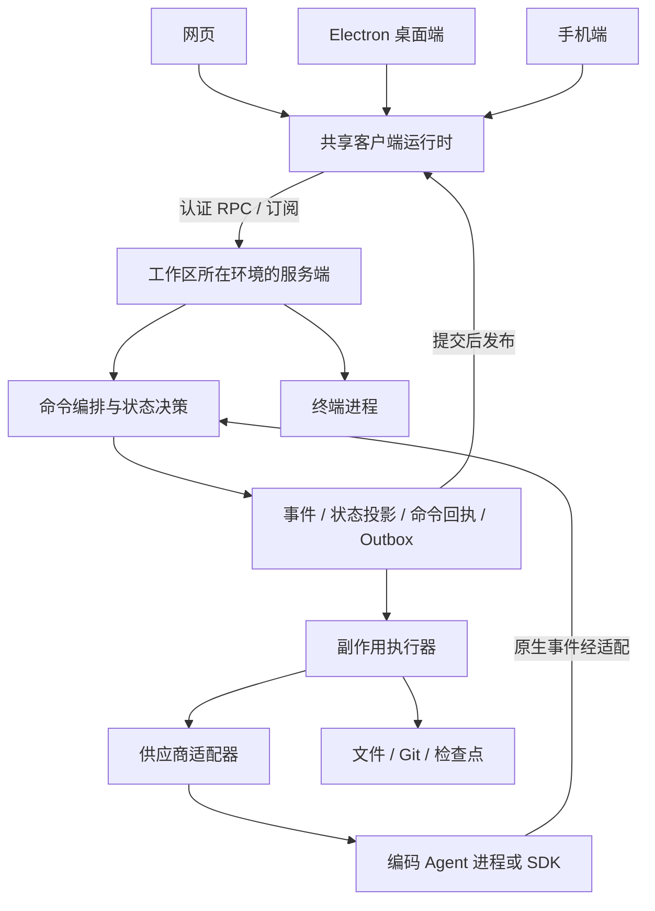

# T3 Code 原理分析与 AiAgent 可借鉴方向

> 调研日期：2026-11-11。上游：[pingdotgg/t3code](https://github.com/pingdotgg/t3code)。
> 本文固定分析提交 `b883156e269de2002873aebdef6019f336b687a7`，以该版本文档、核心源码和依赖声明为依据；未安装运行 T3 Code，未做性能测试。文中的 AiAgent 建议属于设计判断，并非已实现功能。

## 1. 先说结论

**T3 Code 是一个 Agent 工作台：在工作区所在机器运行 Agent，由网页、桌面和手机统一控制，并把会话、执行过程、文件变更与 Git 工作流连起来。**

它的产品价值来自两层：底层复用现有编码 Agent 的执行能力，上层解决多会话管理、远程操作、状态同步、权限交互和改动审阅。供应商仍负责模型推理及自身工具循环，T3 负责让这些能力成为一个可操作、可恢复的产品。[项目说明](https://github.com/pingdotgg/t3code/blob/b883156e269de2002873aebdef6019f336b687a7/README.md)

对 AiAgent，我最建议借鉴的顺序是：

1. **可靠执行底座**：服务端命令去重、持久化运行状态、事件补发。
2. **真实能力驱动的 Agent 适配**：界面和编排依据能力，减少供应商判断分散。
3. **改动审阅闭环**：会话关联工作区、检查点、Diff、验证结果与审批快照。
4. **统一连接管理**：把连接健康、数据同步和任务状态分开。
5. **远程环境与多端控制**：在前面的基础稳定后扩展。

不建议为了借鉴而把现有 .NET 后端重写为 TypeScript，也不建议先做一整套手机端和远程中继。

## 2. 整体架构：控制端与执行环境分离



图中有两个不同循环：Agent 内部负责“推理—工具—继续推理”；T3 的编排层负责“接收操作—保存意图—执行—接收结果—更新界面”。不能因为有外层编排，就再随意制造一套模型续跑循环。

关键边界是：**文件、Git、终端、供应商进程属于执行环境**。手机或远程浏览器发起操作时，操作的仍是那台执行机器的工作区。Electron 虽然捆绑服务端，其渲染界面也遵守同样边界。[架构总览](https://github.com/pingdotgg/t3code/blob/b883156e269de2002873aebdef6019f336b687a7/docs/internals/overview.md)

### 主要模块

| 模块 | 职责 | 可以理解为 |
| --- | --- | --- |
| `apps/web` | React 界面、路由、交互 | 用户操作台 |
| `apps/desktop` | Electron 宿主及本地服务生命周期 | 桌面外壳和系统接入 |
| `apps/server` | RPC、编排、文件、Git、终端和供应商管理 | 执行控制中心 |
| `packages/contracts` | 共享协议及数据 Schema | 客户端与服务端的契约 |
| `packages/client-runtime` | 连接、重连、缓存、状态同步 | 各端共用的客户端逻辑 |
| `packages/provider-core` 与各供应商包 | 统一 Agent 接入与能力表达 | 协议适配层 |
| `orchestration-v2` | 命令、事件、投影与副作用调度 | 可持久化的运行编排 |

技术上使用 TypeScript monorepo、React、Electron、Effect 及服务端持久化组件。Effect 在这里用于服务依赖、并发、资源生命周期和错误建模；真正值得移植的是边界与行为契约。[服务端依赖](https://github.com/pingdotgg/t3code/blob/b883156e269de2002873aebdef6019f336b687a7/apps/server/package.json)、[前端依赖](https://github.com/pingdotgg/t3code/blob/b883156e269de2002873aebdef6019f336b687a7/apps/web/package.json)

## 3. 核心机制拆解

### 3.1 接入编码 Agent，并统一其协议

不同 Agent 使用不同的协议、SDK、进程与会话机制。T3 在适配器边界处理这些差异，向上提供统一命令和事件。

这里要区分三件事：

- **驱动**：接入哪一种 Agent。
- **实例**：该驱动的一份配置和账号生命周期。
- **能力**：当前接入实际支持哪些操作，例如恢复、回滚、分叉、执行中追加指令、审批。

两个账号即使使用同一驱动，也不能共享可变会话与模型目录状态。界面是否显示回滚或计划入口，应由能力决定。恢复原会话失败时，也不能悄悄新建会话冒充恢复。[供应商约束](https://github.com/pingdotgg/t3code/blob/b883156e269de2002873aebdef6019f336b687a7/docs/internals/providers.md)、[适配器接口](https://github.com/pingdotgg/t3code/blob/b883156e269de2002873aebdef6019f336b687a7/packages/provider-core/src/server/ProviderAdapter.ts)

**借鉴价值：**增加一种 Agent 时，主要新增适配器和能力声明，业务状态机与页面无需到处增加供应商分支。

### 3.2 先保存命令意图，再执行外部操作

这是我认为最值得研究的设计。

例如用户发送一条消息：

1. 服务端接收带命令 ID 的请求，串行决策。
2. 在同一个数据库事务中保存事件、状态投影、命令回执和待执行副作用。
3. 事务提交后，再向订阅者发布事件。
4. 执行器读取待办，调用供应商或进行文件操作。
5. 操作结果反馈给编排层，形成后续状态。

`EventSink` 提供 `commitCommand`、`writeWithEffects` 等入口；`EffectWorker` 执行供应商控制、检查点回滚等外部操作。[EventSink 源码](https://github.com/pingdotgg/t3code/blob/b883156e269de2002873aebdef6019f336b687a7/apps/server/src/orchestration-v2/EventSink.ts)、[EffectWorker 源码](https://github.com/pingdotgg/t3code/blob/b883156e269de2002873aebdef6019f336b687a7/apps/server/src/orchestration-v2/EffectWorker.ts)

这样能解决“服务端已经接收，但客户端没收到确认，又发了一遍”的一类问题。**收到命令回执表示意图已持久化，并不表示 Agent 已完成任务。**

同时要理解它的限度：数据库事务无法保证外部 CLI 恰好执行一次。若进程在执行后、结果写回前退出，仍需要结合执行标识、进程归属和恢复策略判断；绑定已丢失供应商进程的副作用不能直接重放。[持久意图与副作用说明](https://github.com/pingdotgg/t3code/blob/b883156e269de2002873aebdef6019f336b687a7/docs/internals/overview.md#durable-intent-and-side-effects)

### 3.3 状态投影负责查询，短期事件负责补发

T3 将当前可查询状态持久化为投影，客户端通过快照与事件订阅同步。

需要特别注意：该版本会裁剪旧事件，事件日志主要保留约一天的重连与重试所需历史，存在部分保留例外。**因此不能把它理解为“保存全量事件，随时从零重建全部数据”的完整事件溯源系统。**

客户端游标落在已裁剪区间时，需要重新读取快照；命令回执的去重生命周期也不能简单跟随事件删除。[事件裁剪与恢复规则](https://github.com/pingdotgg/t3code/blob/b883156e269de2002873aebdef6019f336b687a7/docs/internals/overview.md#durable-intent-and-side-effects)

**借鉴价值：**浏览器刷新后能够知道“实际执行到哪里”，而不是仅靠上次组件内存恢复；同时控制历史事件的数据量。

### 3.4 连接只有一个重试负责人

网页、桌面与手机共享每个环境的连接管理逻辑。连接监督器负责退避重连，视图消费状态，避免多个页面各自重连。

它明确区分：

| 状态 | 代表什么 |
| --- | --- |
| 连接健康 | 通道是否可用 |
| 同步就绪 | 配置、列表、会话内容是否已经追上服务端 |
| 运行状态 | Agent 正在执行、等待输入、结束还是失败 |

Socket 打开不等于数据就绪；列表订阅失败也不等于整条连接断开。恢复连接不会自动重放写操作，写操作有自己的去重规则。[连接运行时](https://github.com/pingdotgg/t3code/blob/b883156e269de2002873aebdef6019f336b687a7/docs/internals/connection-runtime.md)

**借鉴价值：**切换会话、窗口重新激活、短暂断网时，各处显示一致，避免“页面显示完成但后台仍在运行”。

### 3.5 检查点把会话与代码变化连起来

T3 使用隐藏 Git 引用保存工作区检查点，不往用户当前分支插入普通提交。检查点接口支持捕获、恢复与差异读取。

更重要的是，回滚需要协调文件状态与供应商会话状态：如果只把代码退回，而 Agent 仍记得修改后的代码，后续操作可能基于错误上下文。因此不支持会话回滚的供应商必须在修改文件之前拒绝该操作。[检查点说明](https://github.com/pingdotgg/t3code/blob/b883156e269de2002873aebdef6019f336b687a7/docs/internals/overview.md#turn-completion-and-checkpoints)、[CheckpointStore 源码](https://github.com/pingdotgg/t3code/blob/b883156e269de2002873aebdef6019f336b687a7/apps/server/src/checkpointing/CheckpointStore.ts)

**借鉴价值：**让用户按一次 AI 执行审阅修改、比较前后版本，并在满足条件时回退。检查点本身不解决多任务同时修改同一工作区的问题，还需要工作区隔离或冲突检测。

### 3.6 Agent 结束与收尾完成是两个里程碑

模型停止输出后，检查点、Diff、PR 发现等收尾工作仍可能进行。T3 分开记录供应商执行状态与运行收尾，避免把 Git 收尾耗时算作模型运行耗时。[运行结束边界](https://github.com/pingdotgg/t3code/blob/b883156e269de2002873aebdef6019f336b687a7/docs/internals/overview.md#turn-completion-and-checkpoints)

**借鉴价值：**AiAgent 可以清楚显示“AI 已结束，正在整理改动”，并在收尾失败时保留回答和代码，提供单独重试收尾的能力。

### 3.7 权限在执行环境校验，连接成功不代表全部授权

T3 为 RPC 方法声明所需权限，Socket 认证通过后，每个方法仍要授权。网页、终端、MCP 客户端与访客链接具有不同入口和授权语义。[环境认证](https://github.com/pingdotgg/t3code/blob/b883156e269de2002873aebdef6019f336b687a7/docs/internals/environment-auth.md)

但它有一个不能直接照搬到 AiAgent 的前提：**T3 把环境作为文件系统边界，项目主要用于组织；其 `filesystem:read` 可读取服务账号有权访问的项目外文件。**

AiAgent 是多用户内网工作台，必须继续逐次校验用户、项目、仓库和允许根目录。远程可连接、拥有某种 Agent 权限，都不能替代项目访问控制。

## 4. 和 AiAgent 当前实现对照

本节依据本地源码抽查，不是全仓库能力审计。

| 方向 | AiAgent 已有基础 | 建议借鉴的增量 |
| --- | --- | --- |
| 运行抽象 | `RuntimeContracts`、`RunCoordinator` 已统一运行与事件概念 | 在现有抽象上补能力声明、实例隔离与兼容策略 |
| 运行持久化 | `AgentRunStore` 已保存运行、事件和序号 | 评估命令回执、状态与事件原子性、补发游标和快照契约；不能说当前没有事件存储 |
| 目标模式 | `GoalJson`、版本校验、原生 thread 恢复、暂停与部分结果保存 | 若产品要支持离线继续，再新增明确后台模式、执行租约及恢复策略 |
| 连接与重试 | `ChatStreamProvider` 集中管理流、普通失败重试，目标请求禁止通用重发 | 区分恢复订阅和重新执行；明确服务端命令 ID，不能把前端 stream ID 等同于服务端去重 |
| 代码交付 | `CodeDeliveryAppService` 已有变更集、校验、审批和交付入口 | 把运行检查点、Diff 和测试证据关联到已有变更集 |
| 多端 | 已有网页与 KunBuddy 客户端 | 先统一协议、连接和状态语义，再评估共享纯客户端逻辑 |

本地依据：

- [运行契约](../backed/Services/AgentRuntime/RuntimeContracts.cs)
- [运行协调器](../backed/Services/AgentRuntime/RunCoordinator.cs)
- [运行与事件存储](../backed/Services/AgentRuntime/AgentRunStore.cs)
- [Codex 目标执行](../backed/Services/Chat/Codex/CodexChatService.Goals.cs)
- [目标模式边界](chat-goal-mode.md)
- [聊天流管理](../front/components/chat/ChatStreamProvider.tsx)
- [代码交付入口](../backed/Services/CodeDelivery/CodeDeliveryAppService.cs)

特别提醒：当前目标模式明确是“单 API 实例、浏览器在线执行”，断线会暂停。后台继续是产品语义变更，不能借重构之名静默改变；原生 Codex 仍必须独占目标续跑调度。

## 5. 建议落地清单

下面的 P0/P1/P2 表示建议顺序，不代表已确认缺陷或已估算排期。

| 优先级 | 建议 | 用户收益 | 关键验收 |
| --- | --- | --- | --- |
| P0 | 服务端持久化命令 ID 和回执 | 网络重试时减少重复执行 | 同一命令重复提交只接受一次；越权、参数冲突仍被拒绝 |
| P0 | 运行快照与序号补发接口 | 刷新后准确恢复状态 | 断线补发无重复、无缺口；游标过期读取快照；旧响应不覆盖新状态 |
| P0 | 分开执行、连接、同步、收尾状态 | 状态提示更可信 | 通道恢复不冒充任务重启；Diff 失败不丢 AI 回答 |
| P1 | Provider 能力与实例契约 | 不同 Agent 行为更一致 | 不支持的恢复、回滚、图片和权限模式明确隐藏或拒绝 |
| P1 | 后台执行作为显式可选模式 | 长任务不依赖页面持续打开 | 在线模式保留断线暂停；后台模式有授权快照、租约、预算、取消与审计 |
| P1 | 会话关联工作区与检查点 | 更容易定位本轮改动 | 并行任务不互相污染；回退前核验文件变化与会话能力 |
| P1 | 检查点关联现有变更集 | 从 AI 执行直接进入审阅 | 运行、Diff、校验结果、审批指纹对应同一快照；变更后审批失效 |
| P1 | 协议录制回放测试 | 适配器升级更稳定 | 使用脱敏原始协议驱动真实适配、状态机与存储，而非只注入成功事件 |
| P2 | 网页与 KunBuddy 共享连接和同步逻辑 | 多端表现一致 | 不把 Electron、React Native 或宿主权限逻辑混入纯状态层 |
| P2 | 远程执行环境目录与能力协商 | 统一控制不同开发机 | 环境 ID、用户、项目和根目录绑定；离线环境不能回退到另一台执行 |
| P2 | 基于固定差异的 AI 审阅导览 | 人工审批更省力 | 全文件覆盖、证据链接、快照过期提示；模型总结不替代实际测试 |

T3 的协议回放测试值得单独参考：替换外部进程或网络传输，保留真实编排、适配器、归一化、存储与投影，覆盖停止、恢复、工具审批和进程退出等场景。[测试策略](https://github.com/pingdotgg/t3code/blob/b883156e269de2002873aebdef6019f336b687a7/docs/orchestration-v2/testing-strategy.md)

AI 审阅导览也是很适合 AiAgent 的产品借鉴：按改动阅读顺序组织重点，标注需要人工判断的地方，代码变化后让旧导览失效。应围绕 AiAgent 已有变更集实现，先服务本地审批，再考虑不同代码托管平台。[T3 审阅导览](https://github.com/pingdotgg/t3code/blob/b883156e269de2002873aebdef6019f336b687a7/docs/user/source-control.md#review-guides)

## 6. 推荐的最小实施切口

第一步选择一个受控的普通聊天执行入口，验证以下链路，不同时重写所有引擎：

```text
用户发送
  → 校验当前身份、项目和请求快照
  → 持久化命令与回执
  → 服务端建立运行记录
  → 调用现有执行引擎
  → 持久化状态及允许保留的输出
  → 客户端按序号订阅
  → 刷新后读取快照并补发
```

第一步至少测四种故障：

1. 请求已经接受，但客户端没有收到确认。
2. 运行中断线，随后恢复订阅。
3. 服务端重启，供应商进程已丢失。
4. AI 已结束，但检查点或 Diff 整理失败。

先保证“不重复启动、状态可解释、结果可恢复”，再把命令与副作用原子入队扩展到后台任务。服务端持久化命令记录本身并不代表已解决执行崩溃窗口，最终仍需 Outbox、执行归属和不确定结果处理共同完成。

## 7. 不宜直接照搬的设计

- **完整技术栈迁移**：现有 .NET 运行抽象、SqlSugar 存储与前端 API 层可以承载这些模式；换框架本身没有证明收益。
- **单用户机器信任模型**：T3 的环境权限不能替代 AiAgent 的人员与项目隔离，终端尤其需要独立授权。
- **直接沿用默认权限模式**：必须按 AiAgent 的服务端策略和引擎真实能力映射，不能用界面标签模拟安全能力。
- **检查点等于交付或备份**：检查点服务于执行审阅；正式交付继续经过现有变更集、人工审批与指纹复核。
- **有事件表就能永久审计**：短期补发、长期审计、消息历史和诊断日志应分别制定保留规则。
- **后台可恢复就自动续跑所有任务**：服务重启、凭据变化、权限变化及执行结果不确定时，需要明确恢复策略。
- **一次接完所有供应商**：先验证现有 Codex 与 Native 两条路径的完整行为，再按实际需求增加。

## 8. 我的判断

AiAgent 已经有知识库、企业任务、代码交付和管理能力。T3 Code 最有帮助的方向，是让这些能力围绕一次执行形成稳定闭环：

**任务 → 会话 → 执行 → 文件改动 → 验证证据 → 人工审批 → 交付。**

如果只选三件事，建议先做：**命令去重与运行恢复、Agent 能力契约、运行改动与变更集关联**。它们能直接改善可靠性和交付体验，也为后续后台长任务及多端控制建立基础。
